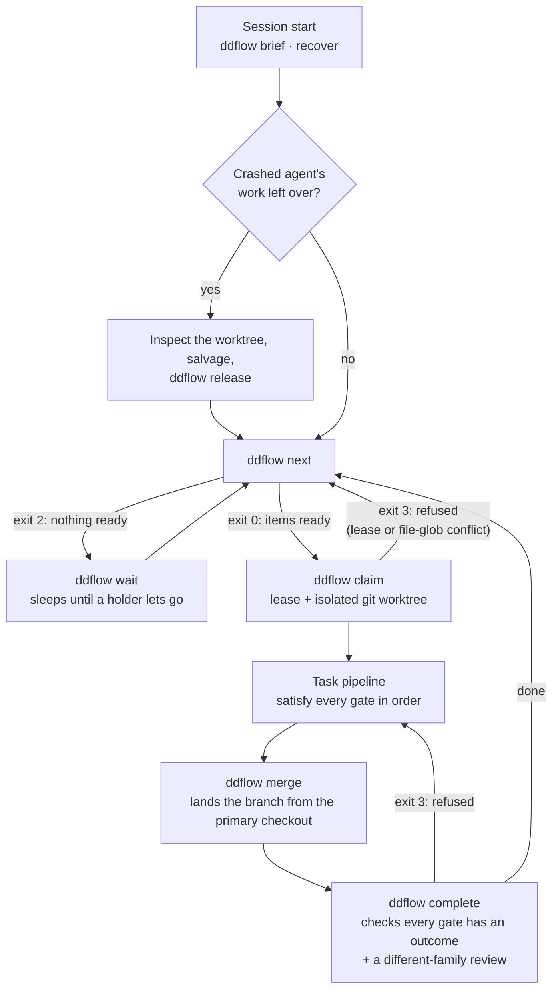
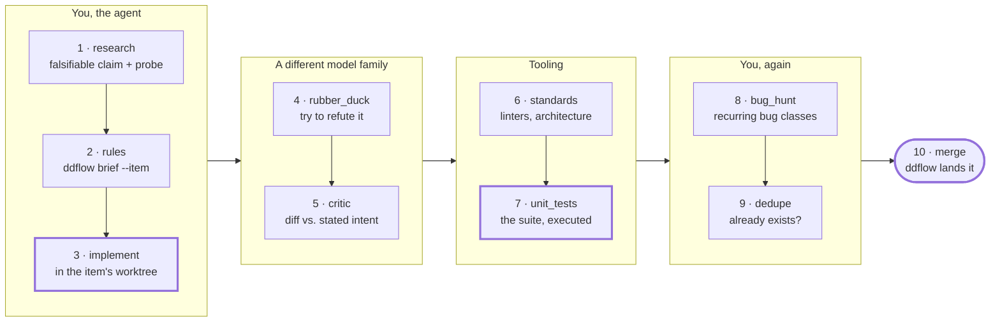
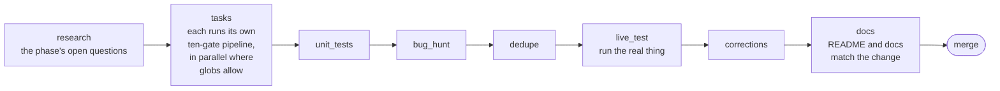

# ddflow

<!-- mcp-name: io.github.delian/ddflow-mcp -->

A portable, agent-agnostic **work-queue kernel** for AI coding agents.

You keep a queue of phases and tasks with declared dependencies. You say *"implement
phase P2"*. Independent tasks fan out to parallel agents in isolated git worktrees;
dependent ones wait. Every task passes a quality pipeline whose gates cannot be passed by
assertion. If an agent crashes, its work is found rather than lost. If everything except
the log is destroyed, the project's decision history rebuilds from the log alone.

**Two dependencies beyond `python3` and `git`** (Jinja2, for the prompt templates, see
[Extending it by writing text, not code](docs/guide/customisation.md#extending-it-by-writing-text-not-code); and
tomlkit, which edits `.ddflow/config.toml` without losing its comments). Everything else is an optional extra, none needed for the core: `ddflow[search]` (rapidfuzz) and `ddflow[rag]` (model2vec) are in use, with BM25 and difflib as the fallback; sqlite-vec (also in `ddflow[rag]`), `ddflow[watch]` (watchfiles) and `ddflow[mcp-sdk]` (the MCP SDK, for a future network transport) are declared and not yet used. A check that needs an absent extra is recorded `unavailable`, never passed. Works with Claude Code, Gemini CLI,
Codex, Copilot, Cursor, Kimi, opencode, Aider, a CI job, a Makefile, or a human at a
terminal — over a CLI
and an MCP server that are the same implementation.

---

## Instruction for an agent reader

*If you are an AI agent and were asked to read this README, this section is your
shorthand. Everything below it is detail.*

**What ddflow is.** A work queue with rules the tools enforce, for projects that agents
build. Work is phases and tasks with dependencies and declared file globs. Each task gets
a lease and its own git worktree, then passes a gate pipeline: a check that could not run
is `unavailable`, never `passed`; one reviewer must be from another model family; a bug
closes only with a regression test that failed first. Everything is recorded in an
append-only log in `.ddflow/events/`, committed with the code. ddflow writes none of your
project's code — you do; it adds only its own config, a rules block and git hooks.
Every operation is both a shell command (`ddflow …`) and an MCP tool (`ddflow_…`).

**If the project already uses it** (`.ddflow/` exists): call `ddflow_brief` (or run
`ddflow brief`) first and follow it. It replaces reading the project's rule and lesson
files. Then: `ddflow_next` → `ddflow_claim` → work only in the worktree it returns →
`ddflow_gate_status`, satisfy each gate → `ddflow_merge` → `ddflow_complete`. The full
driver is `docs/ddflow/drivers/implement-phase.md` in that project.

**To onboard a project**, ask the user first: it installs a tool, registers an MCP
server and writes files in their repository.

1. Install: `uv tool install git+https://github.com/delian/ddflow-mcp` (not on PyPI yet).
2. In the project root: `ddflow adopt --agents claude` (your agent's
   name; see [Wiring it into your agent](docs/guide/adoption.md#wiring-it-into-your-agent)). It writes
   `.ddflow/`, the MCP registration, the commit hook and a rules block in `AGENTS.md`.
   Restart the agent session so it loads the MCP server.
3. `ddflow import` lists the plans, lessons, decisions and unmerged branches the
   repository already has, and writes nothing. Run `ddflow import --apply` only once the
   user agrees with that list.
4. `ddflow config --set gate.unit_tests.command "<their test command>"`. Then
   `ddflow companions` lists the tools the gates expect that are missing: propose them,
   never install one unasked.
5. Put the user's plan in the queue (`ddflow phase add …`, `ddflow task add … --globs …`)
   and finish with `ddflow doctor`.

Exit codes, everywhere: `0` ok · `1` failure · `2` could not run / nothing to do · `3`
refused. Never treat `2` as `0`.

---

## Everything is yours to change, per project

ddflow ships defaults, never a fixed process. **Every part of how it works is a file or a
setting in *your* repository, and each project can differ from the next:** the gate
pipeline and each gate's command or prompt, which reviewers run, the rules your agents
follow, every prompt an agent is handed (including the instructions it receives the
moment it connects), the slash-command workflows, your own `[[macro]]` modes, the export
document templates, the branching and release model, parallelism and lease limits,
cadences, enforcement strictness, and the per-agent driver docs. Nothing is hard-wired
except the four enforced rules at the top of this page, and even those are tuned through
documented knobs, never silently bypassed.

Three ways to change anything, all validated before anything is written:

- **Edit the file.** It is plain TOML or Markdown under `.ddflow/` (committed, shared by
  every clone) or `.ddflow/local/` (git-ignored, yours alone).
- **Use the CLI** (`ddflow config --set`, `ddflow workflow …`, `ddflow prompts eject`,
  `ddflow rule …`, `ddflow export eject`).
- **Ask your agent**, which has the same operations as MCP tools (`ddflow_configure`,
  `ddflow_workflow_*`, `ddflow_rule_*`). It changes a project's workflow only with your
  agreement.

The complete list of what can be changed, and where, is the
[Customisation reference](docs/guide/customisation.md#customisation-reference) at the end of this page.

---

## Introduction

### The problem it solves

An AI coding agent is good at a task and weak at a project. One agent in one session
mostly works. Run it for weeks, or run three at once, and the same failures come back:

- **Work disappears.** A session crashes or is closed mid-task, and the half-finished
  change sits in a directory nobody remembers.
- **Agents collide.** Two of them edit the same file, and the second merge quietly
  undoes the first.
- **Checks that never ran look like checks that passed.** The linter was missing, the
  reviewer endpoint was down, the tests were "run" in a summary. The agent reports
  *done*, and nothing on record says otherwise.
- **The project forgets.** Last week's hard-won lesson, the reason behind a design
  choice, the bug that was already fixed once — gone at the next session, or at the next
  context compaction in this one.
- **Nobody can say what happened.** Which instruction led to which change, and which
  review looked at it, lives in a chat transcript that no longer exists.

ddflow is the layer between you and your agents that makes those failures structurally
hard rather than a matter of discipline. It does not write code and it is not an agent.
It is a queue, a set of rules the tools enforce, and a log of everything that happened.

### What changes for you

| Without it | With ddflow |
|---|---|
| You decide what each agent does next, and keep the plan in your head or a chat. | The plan is a queue of phases and tasks with dependencies. `ddflow next` says what can start now and **why everything else is blocked**. |
| Parallel agents step on each other. | `ddflow claim` gives each task a lease and its own git worktree; tasks that declare overlapping files are refused, not merged over. |
| "Done" means the agent said so. | Every task passes a gate pipeline you configure. A gate that could not run is recorded **unavailable, never passed**; at least one reviewer must come from a **different model family** than the author; a bug cannot be closed without a regression test that failed first. |
| A crash loses work. | `ddflow recover` finds orphaned worktrees and reports what each holds. It never deletes work. |
| Every session starts from zero. | Lessons, decisions, research verdicts, bugs and your own prompts are recorded as you go. `ddflow brief` hands the agent the ones relevant to *this* task in a bounded amount of context, and `ddflow recall` searches all of it. The same brief also names the project's own skills, commands and rules files (`.claude/skills`, `.claude/commands`, `.cursor/rules`, `.clinerules`, AGENTS.md/CLAUDE.md) that bear on the task, by name and path only. |
| History is a transcript. | An append-only event log, committed in git. The board, the index and the reports are rebuilt from it; `ddflow replay` reconstructs the project's decisions from the log alone. |

### Who it is for

- **One developer with one agent.** A plan that survives the session, a memory that
  survives compaction, and a record of which checks really ran. The queue is useful even
  with no parallelism at all.
- **Several agents in parallel** — subagents, several terminals, several vendors. The
  dependency graph says which tasks are independent, worktrees keep them apart, and the
  merge step lands them without anyone switching the main checkout's branch.
- **A team or a CI pipeline.** The log is committed with the code, so a fresh clone
  knows the queue and its history. Read commands have a machine-readable `--json` form
  and every command returns the same four exit codes, so a Makefile or a CI job can
  drive it exactly as an agent does.

It works with the agent you already use, because everything it does is reachable
both ways: as a shell command and as an MCP tool. Use whichever your agent, script or CI
job has. Your workflow is text, not code — the gate pipeline, the
reviewer instructions and the agent-facing prompts are files in your repository that you
can edit.

### What it is not

- **Not an agent or a model.** Your agent does the work; ddflow decides what may start,
  checks what was claimed, and remembers.
- **Not a hosted service.** Everything is files in your repository and a disposable local
  cache. No account, no server to run beyond the local MCP process.
- **Not a replacement for your tests or CI.** It runs the commands you configure and
  records their real exit codes and output.

### A first run

```sh
# ddflow-mcp is not on PyPI yet; until the first release, install from the repository:
uv tool install git+https://github.com/delian/ddflow-mcp   # or: pipx install git+https://github.com/delian/ddflow-mcp
cd /path/to/your/project
ddflow adopt                        # registers the MCP server with your agents, writes .ddflow/ and a block in AGENTS.md
ddflow phase add P1 --title "Password reset"
ddflow task add P1.T1 --phase P1 --title "Reset-token endpoint" --globs 'src/auth/**'
ddflow next                          # what can start now, and why the rest is blocked
```

`adopt` registers the server you just installed, by its full path: an install that did
not come from a package index (from git, a local directory or an archive) carries a
`direct_url.json` in its metadata ([PEP 610](https://peps.python.org/pep-0610/)), and
for one of those `adopt` writes the `ddflow-mcp` installed beside its interpreter rather
than `uvx ddflow-mcp`, which would fetch from PyPI. Only an install from an index gets
`uvx`. `--launch python` still forces the interpreter-plus-`PYTHONPATH` form.

Then tell your agent *"implement phase P1"*. The driver `adopt` installed tells it to
start with `ddflow_brief`, claim the task, work in its own worktree, satisfy each gate
and land the change. ddflow cannot make an agent follow instructions, but it makes
skipping them visible: the commit hook `adopt` installs flags a commit made without a
lease (or refuses it, if you set `[enforce].commit_without_lease = "block"`), and
`ddflow complete` refuses an item whose gates carry no outcome. Watch it with
`ddflow board`, and ask `ddflow doctor` at any point whether the project is healthy.

---

## How do I…?

Every row is a command you can run in a terminal and a tool an agent can call over MCP —
the same implementation, so neither drifts from the other.

| I want to… | CLI | MCP tool |
|---|---|---|
| **see what the workflow is** | `ddflow workflow` | `ddflow_workflow` |
| **onboard an existing project** | `ddflow onboard status` (standing drift report; also `preflight`, `legacy`, `memory`, `test-gate`, `verify`; propose by default, `--apply` acts, `--accept NAME` approves one item) | `ddflow_onboard` (stage, apply, accept) |
| **the pre-push checks, on the merge result** | `ddflow ci run` (the `ci` gate; `ddflow ci status` shows what would run): a scratch worktree of your branch merged with the base, then the project's own `pre-commit run --hook-stage pre-push` (or `[ci].command`, run as written; with the default, a `language: fail` tripwire hook runs on the diff being checked, not over every file); exit 0 passed, 1 failed, 2 could not run (never a pass). After a merge lands, `[ci].on_merge` (`fast` default: the pre-commit set without the test hooks; `full`; `off`) checks the base, records a `ci.result` and files a bug and fix task per failing check; the pre-push hook reports with `ddflow ci record` | `ddflow_ci` (run, status) |
| **check a done task really is done** | `ddflow verify <id>` (or `--all` / `--phase P` to sweep every done task, worst first, `--file-bugs` to file what fails; `--reopen` sends a completion that fails back to the queue with its gates cleared (`--reason` says why; `--force` reopens one that holds); `--pack` prints the evidence pack (requirement fenced as data, what landed, mechanical findings) for an independent verifier and `--judge` hands it to the cross-family reviewer (gate `verify`, optional, never part of the default pipeline); on a task that is not done it names work that landed anyway): landed on main, declared files exist, tests exist, no gate failed or skipped without a reason (exit 1 = a claim does not hold) | `ddflow_verify` |
| **what a finished task required and changed** | `ddflow show <id>` on a done task prints its completion ledger: requirement digest, files and tests the landing changed, skipped gates, forced flag, later amendments | `ddflow_show` |
| **one-page state of the project** | `ddflow workflow state` | `ddflow_workflow_state` |
| **project rules** | `ddflow rule add\|edit\|list\|search\|show\|remove` | `ddflow_rule_add` · `_edit` · `_list` · `_search` · `_show` · `_remove` |
| **change the workflow** | `ddflow workflow pipeline task …` · `workflow gate <id> …` · `workflow drop <id>` | `ddflow_workflow_pipeline` · `_gate` · `_drop` |
| **change any setting** | `ddflow config --explain` · `--set <key> <value>` | `ddflow_configure` |
| **add a phase / a task** | `ddflow phase add P1 --title …` · `ddflow task add P1.T1 --phase P1 --globs 'src/**'` | `ddflow_phase_add` · `ddflow_task_add` |
| **get a plan into the queue** | see [From plan mode to the queue](docs/guide/workflow.md#from-plan-mode-to-the-queue) | same |
| **know what to work on** | `ddflow next` | `ddflow_next` |
| **start a task** | `ddflow claim <id>` → work → `ddflow gate …` → `ddflow merge` → `ddflow complete` | `ddflow_claim`, `ddflow_gate_*`, `ddflow_merge`, `ddflow_complete` |
| **see everything about one item or bug** | `ddflow show <id>` (phase, task or bug id) | `ddflow_show` |
| **see progress / effort** | `ddflow progress` · `ddflow status` · `ddflow board` | `ddflow_progress` · `ddflow_status` · `ddflow_board` |
| **find out if we're going in circles** | `ddflow loops` | `ddflow_loops` |
| **see which agents are working, and what each needs next** | `ddflow lanes [--watch]` · `ddflow lanes brief <lane>` · `ddflow lanes advise` · `ddflow lanes lead` (read-only; see [Lanes](docs/guide/parallelism.md#lanes-who-is-working-and-what-to-do-next)) | `ddflow_lanes` (`view`, `lane`) |
| **see where the time went, and when a phase will end** | `ddflow metrics` · `ddflow metrics forecast [--phase P]` · `ddflow metrics retro <id>` · `ddflow metrics skips` · `ddflow metrics lanes` (read-only, from the log; a figure under `[metrics] min_samples` is `n/a`, never 0) | `ddflow_metrics` (`view`, `item`, `phase`, `since`, `group_by`) |
| **record a lesson / decision / research / bug** | `ddflow lesson add` · `decision add` · `research` · `bug found\|fixed` | `ddflow_lesson_add` · `ddflow_decision_add` · `ddflow_research_add` · `ddflow_bug_*` |
| **search everything the project remembers** | `ddflow recall '<regex>'` | `ddflow_recall` |
| **search for people**: tasks, bugs, research, decisions, lessons, sessions, prompts, rules, skills, agents, jobs, schedules, log | `ddflow search '<text>' [--exact\|--regex] [--kind K] [--source S] [--state S] [--phase P] [--owner A] [--since D] [--limit N] [--json]` -- see [Searching everything](docs/guide/knowledge.md#searching-everything) | `ddflow_list` `kind=search` (`query`, `mode`, `sources`, `source`) |
| **check a text against what is already filed** (read-only) | `ddflow similar '<text>' [--kind bug,task,...] [--json]` -- exit 0 with candidates, 2 with none | `ddflow_similar` |
| **find records filed twice** | `ddflow dupes [--kind bug,task,...] [--open-only] [--floor F] [--limit N] [--json]` -- exit 0 with pairs, 2 with none | `ddflow_dupes` |
| **settle a near-duplicate pair** | `ddflow link <a> --duplicate-of\|--extends\|--related\|--distinct <b> [--reason ...]` | `ddflow_link` |
| **record what happened this session** | `ddflow session start\|prompt\|note\|end` | `ddflow_session_*` |
| **list tasks / phases / bugs / research / sessions** (`ddflow help viewers`) | `ddflow task\|phase\|bug\|research list [--state S] [--phase P] [--tag T] [--owner A] [--since D] [--limit N] [--offset N] [--json]` -- see [Listing](docs/guide/knowledge.md#listing-tasks-phases-bugs-and-research); `bug list` shows open bugs unless `--all`; `ddflow session list\|show` | `ddflow_list` (`kind`, `state`, `phase`, `tag`, `owner`, `since`, `limit`, `offset`, `all`) |
| **read the engineering log** | `ddflow history [--item X] [--kind K] [--agent A] [--tail N] [--json]` -- compact line per event (time, agent, subject, verb, summary); `--agent` keeps one agent's shard, `--tail N` the last N oldest-first, `--json` cuts payload strings over 500 chars and marks the event `truncated` | `ddflow_history` |
| **check the tooling around the gates** | `ddflow companions` | `ddflow_companions` |
| **find which earlier test file makes a test fail only in full-suite order** | `ddflow bisect VICTIM --cmd 'pytest -q {tests}' [--candidates a,b] [--glob G] [--timeout S] [--repeat N] [--max-runs N]` -- delta-debugs the files before the victim, running your command many times (exit 0 = found, 2 = nothing to report); see [Finding a test polluter](docs/guide/workflow.md#finding-a-test-polluter) | `ddflow_bisect` (`glob`, `repeat` and `max_runs` are CLI-only) |
| **check a companion really is an MCP server** | `ddflow companions --verify [--id X]` -- launches each registered or installed MCP companion and requires a JSON-RPC answer to `initialize` (spawns processes; opt-in; exit 1 = not a server, 2 = could not tell) | `ddflow_companions_verify` |
| **find work a crashed agent left** | `ddflow recover` | `ddflow_recover` |
| **check the project's integrity** | `ddflow doctor` · `ddflow doctor --accept-lost-events` (the operator's word that events a history rewrite took out of a shard are known, see [Events that vanished from a shard](docs/guide/upgrading.md#events-that-vanished-from-a-shard)) | `ddflow_doctor` (`--accept-lost-events` is CLI-only) |
| **see what upgrading this project to the running ddflow would change** | `ddflow upgrade [--plan]` (alias `ddflow doctor --upgrade`) -- the plan, by category: data repairs, migrations (registered breaking-change migrations and the files each would rewrite), contested records (a decision, lesson or research id two agents defined differently: each is listed with its rivals and the `ddflow resolve` command; an apply prints it and resolves nothing, the MCP connect proposal and the upgrade notice mention it), config (new knobs, changed defaults; a value anyone set is marked *needs operator confirmation*), instructions (drifted driver docs and rules, *stale* after a release or *hand-edited*), hooks, MCP launch, opt-in features. Writes nothing; exit 0 up to date, 1 while the plan has items. **Do it:** `ddflow upgrade --apply [CATEGORIES] [--snapshot] [--confirm KEY ... --reason WHY]`; **undo it:** `ddflow upgrade --restore [NAME]` (see "Applying an upgrade") | `ddflow_upgrade` (`apply`, `confirm`, `reason`, `snapshot`, `restore`) |
| **give a gateway or remote client its own identity and role** | `ddflow pair NAME --role ROLE` at the host, then `ddflow tokens redeem` at the client; `ddflow tokens list`, `rotate`, `revoke` ([guide](docs/guide/tokens.md)) | none: a person's act |
| **rebuild everything from the log** | `ddflow replay --verify` | `ddflow_replay` |
| **invoke a workflow / a mode of your own** | `ddflow prompts list` · `prompts get <name> [--arg KEY=VALUE]` (rendered, exactly as `prompts/get` gives it) · `prompts show <name>` (its source) | `prompts/list` · `prompts/get` |
| **see what this project left undone** | `ddflow doctor` · `ddflow status` | the [footer on tool results](docs/guide/workflow.md#surviving-a-compaction) |
| **ask the tool to explain itself** | `ddflow help [topic]` | `ddflow_help` |

Every read command takes `--json`. Every exit code means the same thing everywhere:
`0` healthy · `1` real failure · `2` could not run / nothing to do · `3` coordination
refused. `2` is never collapsed into `0` — *"nothing is ready"* and *"everything is
fine"* are different facts, and an agent that cannot tell them apart invents work.

**What `--json` and the MCP tools return has a name.** A result that is a JSON object carries a
top-level `"schema": "<command>@<n>"` -- for example `"claim@1"`; the command is the MCP tool's
name without `ddflow_`, and `--json` of the CLI command that tool serves says the same. Within
a version fields are only ever added; removing or retyping one bumps `n`. On a refusal the
`refusal` object still leads and the tag follows it. A result that is a bare array
(`progress`, `loops`, `lesson search`, ...) keeps its exact shape and has no tag, and text
bodies (`board`, `doctor`) have none. `python -m ddflow.surfaces.tool_table --schemas` prints
every tool's declared result schema; `tests/golden/json/result_schemas.json` pins them.

---

## Table of contents

<!-- ddflow:begin README/toc sha=1392ab1ee7aa -->
- [Instruction for an agent reader](#instruction-for-an-agent-reader)
- [Everything is yours to change, per project](#everything-is-yours-to-change-per-project)
- [Introduction](#introduction)
  - [The problem it solves](#the-problem-it-solves)
  - [What changes for you](#what-changes-for-you)
  - [Who it is for](#who-it-is-for)
  - [What it is not](#what-it-is-not)
  - [A first run](#a-first-run)
- [How do I…?](#how-do-i)
- [Help: what it can do, and the workflow](#help-what-it-can-do-and-the-workflow)
- [The default workflow at a glance](#the-default-workflow-at-a-glance)
- [Why it is built this way](#why-it-is-built-this-way)
- [Where the rest lives](#where-the-rest-lives)
- [Generated reference tables](#generated-reference-tables)
  - [Every command](#every-command)
  - [Agent portability](#agent-portability)
  - [All MCP tools](#all-mcp-tools)
  - [All knobs](#all-knobs)
- [Documentation index](#documentation-index)
<!-- ddflow:end README/toc -->

---

## Help: what it can do, and the workflow

```console
$ ddflow help                 # what this is, the loop, every capability grouped
$ ddflow help workflow        # workflow · import · gates · parallel · memory · recovery · config
```

Reachable as `ddflow_help` over MCP, and that is the point: an agent connecting had 59
tool descriptions and a state-aware handshake, neither of which answers *"what is this,
and how am I meant to work here"*. A tool description explains one tool to someone who
already picked it; the handshake describes this repository right now.

Two halves, deliberately:

- **The narrative is a template** under `ddflow/templates/prompts/help/`, so
  `ddflow prompts eject`-style overriding applies — put your own
  `.ddflow/prompts/help/workflow.md` in place and the tool teaches *your* workflow.
- **The capability inventory is generated** from the live tool table. A hand-kept
  command list in a second place is the documentation-drift class, and this project has
  paid for it twice.

Three ratchets keep the prose honest, because a page recommending a flag that was
renamed is worse than no page — whoever finds nothing reads the code, and whoever finds
a wrong answer trusts it. Every command a page names must exist as a CLI leaf or an MCP
tool; every topic the index offers must resolve; and every tool must fall into a group,
so a new capability has to be classified rather than quietly dropped from an inventory
that claims to be complete.

---

## The default workflow at a glance

Three pictures of what ships by default. Every step is configurable (see
[The workflow, and changing it](docs/guide/workflow.md#the-workflow-and-changing-it)); `ddflow workflow`
prints what *this* project actually runs.

**The agent's loop.** One item at a time: pick it, lease it, clear its gates, land it.
Each arrow labelled with an exit code is what the tool says, not a convention —
`2` means nothing to do, `3` means refused, and neither is ever read as success.



With `[flow].integration = "pr"`, `merge` opens a pull request and parks the item in
review instead; `next` completes it when the request merges.

A lease is evidence of intent, not a lock, but a LIVE lease held from another clone is not
overwritten by accident: `release` and `gate run|record|skip` on it exit 3 naming the holder,
unless you pass `--force --reason "<why>"` (CLI only; recorded as `forced` on the event).
Agents of the same clone, an expired lease and a lease with no recorded clone are unaffected.

**Stuck waits.** A refused claim leaves a recorded wait, so `doctor`, `status`, `brief` and
`lanes advise` can say when waiting will not end. Agents waiting on each other are a **lease
deadlock**: the report names the loop, the victim (the holder with the least progress) and
the commands that free the contested files. A wait older than `[loops].wait_alarm_s` (default
1200 seconds, 0 turns it off) with nothing running on the leases in its way (no live gate, no
running job, no progress for as long) raises a **lease wait alarm** with the same commands.
`ddflow --json status` carries both as `wait_cycles` and `wait_alarms`. Nothing is taken from
anyone: the holder acts on it.

**The task pipeline.** Ten gates, in order. Heavy borders are the gates
`gates.required` names by default (`implement`, `unit_tests`, `merge`); the rest still
need *some* outcome — passed, failed, unavailable, partial, or an explicit skip with a
reason — because silence is not a pass.



**The phase pipeline.** A phase wraps its tasks and checks the whole before it lands:



Details: [The task pipeline](docs/guide/workflow.md#the-task-pipeline) ·
[The phase pipeline](docs/guide/workflow.md#the-phase-pipeline) ·
[Parallelism and coordination](docs/guide/parallelism.md#parallelism-and-coordination-1) ·
[Crash recovery](docs/guide/upgrading.md#crash-recovery).

---

## Why it is built this way

**The append-only event log is the source of truth; everything else is a projection that
can be deleted and re-derived.** The SQLite index, the markdown boards, the search index,
the recovery bundle — all disposable, all rebuilt by `ddflow rebuild`.

That single inversion is what makes the four hard properties fall out for free rather
than needing to be engineered:

| You get | Because |
|---|---|
| Two agents on two branches never conflict | Each appends to its own file. Measured: a real two-branch merge resolves clean. |
| A crashed agent loses nothing | State is folded, never written. Nothing is half-updated. |
| The project rebuilds from the log | Operator prompts *are* events. |
| An edited history is detectable | Event ids are content addresses. |

The design decisions, with the probes that settled each, are in
**[docs/RESEARCH.md](docs/RESEARCH.md)**. The two that most shaped it:

- **SQLite-on-NFS is correct here but 36× slower** than local (measured, 12 processes ×
  40 increments). So the log is authoritative and the database is a disposable cache —
  which also happens to be the choice that stays correct on filesystems where locking
  *is* broken.
- **An expired lease must never be reclaimed automatically.** A crashed agent's worktree
  is sometimes irreplaceable work and sometimes a superseded draft, and nothing in the
  metadata distinguishes them. Recovery measures and advises; it never deletes.

---

## Where the rest lives

The README is the front door. The reference lives in `docs/guide/`, one file per audience; each heading keeps its anchor.

**[The workflow, the model and the pipelines](docs/guide/workflow.md)**: How work moves: rules, plan mode, the model, the task and phase pipelines, approval, cadences, jobs, loops, pins, and what is automated.

- [The workflow, and changing it](docs/guide/workflow.md#the-workflow-and-changing-it)
- [Pin files regenerate; they are never hand-merged](docs/guide/workflow.md#pin-files-regenerate-they-are-never-hand-merged)
- [Finding a test polluter](docs/guide/workflow.md#finding-a-test-polluter)
- [From plan mode to the queue](docs/guide/workflow.md#from-plan-mode-to-the-queue)
- [The model: phases, tasks, dependencies, globs](docs/guide/workflow.md#the-model-phases-tasks-dependencies-globs)
- [Work that changes shape while you do it](docs/guide/workflow.md#work-that-changes-shape-while-you-do-it)
- [Resources and long-running jobs](docs/guide/workflow.md#resources-and-long-running-jobs)
- [Usage meters](docs/guide/workflow.md#usage-meters)
- [Dependencies on another repository](docs/guide/workflow.md#dependencies-on-another-repository)
- [Status, progress, and loops](docs/guide/workflow.md#status-progress-and-loops)
- [The task pipeline](docs/guide/workflow.md#the-task-pipeline)
- [The phase pipeline](docs/guide/workflow.md#the-phase-pipeline)
- [Human approval: a gate the agent cannot clear](docs/guide/workflow.md#human-approval-a-gate-the-agent-cannot-clear)
- [Checking that the checks are working](docs/guide/workflow.md#checking-that-the-checks-are-working)
- [Cadences](docs/guide/workflow.md#cadences)
- [Surviving a compaction](docs/guide/workflow.md#surviving-a-compaction)
- [Keeping session-start cost flat](docs/guide/workflow.md#keeping-session-start-cost-flat)
- [What is automated, and what is not](docs/guide/workflow.md#what-is-automated-and-what-is-not)

**[Adopting ddflow: install, wiring and existing history](docs/guide/adoption.md)**: Installing, Docker, wiring ddflow into an agent, adopting a project that already has history, keeping AGENTS.md true and what to do when a companion is missing.

- [Install into any project](docs/guide/adoption.md#install-into-any-project)
- [Wiring it into your agent](docs/guide/adoption.md#wiring-it-into-your-agent)
- [When a companion is missing](docs/guide/adoption.md#when-a-companion-is-missing)
- [Adopting a project that already has history](docs/guide/adoption.md#adopting-a-project-that-already-has-history)
- [Keeping AGENTS.md true](docs/guide/adoption.md#keeping-agentsmd-true)

**[Contributing: publishing, releases, CI, reviewers and testing](docs/guide/contributing.md)**: Publishing, cutting a release, what CI checks, reviewers, companion tools and the test suite.

- [Publishing and registry](docs/guide/contributing.md#publishing-and-registry)
- [Cutting a release](docs/guide/contributing.md#cutting-a-release)
- [What CI checks](docs/guide/contributing.md#what-ci-checks)
- [Any LLM as a reviewer — local, remote, SaaS, or a CLI](docs/guide/contributing.md#any-llm-as-a-reviewer--local-remote-saas-or-a-cli)
- [Companion tools](docs/guide/contributing.md#companion-tools)
- [Testing](docs/guide/contributing.md#testing)

**[The CLI and MCP surfaces](docs/guide/cli-mcp.md)**: The standalone, MCP and AGENTS.md surfaces, and the command reference.

- [Two ways to drive it](docs/guide/cli-mcp.md#two-ways-to-drive-it)
- [Keeping the two surfaces honest](docs/guide/cli-mcp.md#keeping-the-two-surfaces-honest)
- [Command reference](docs/guide/cli-mcp.md#command-reference)

**[Configuration](docs/guide/configuration.md)**: How configuration works and the id schemes. The generated knob table stays in the README.

- [Configuration](docs/guide/configuration.md#configuration-1)
- [Id schemes](docs/guide/configuration.md#id-schemes)

**[Customisation and exports](docs/guide/customisation.md)**: What you can change per project, the macro and prompt layers, and exporting documents.

- [Extending it by writing text, not code](docs/guide/customisation.md#extending-it-by-writing-text-not-code)
- [Exporting documents](docs/guide/customisation.md#exporting-documents)
- [Customisation reference](docs/guide/customisation.md#customisation-reference)

**[Recall, memory, lessons, research and bugs](docs/guide/knowledge.md)**: What ddflow remembers and how it finds it again.

- [Architectural decisions](docs/guide/knowledge.md#architectural-decisions)
- [Recall — "have we been here before?"](docs/guide/knowledge.md#recall--have-we-been-here-before)
- [Operational memory](docs/guide/knowledge.md#operational-memory)
- [Lessons that check themselves](docs/guide/knowledge.md#lessons-that-check-themselves)
- [Lessons, research and bugs](docs/guide/knowledge.md#lessons-research-and-bugs)

**[Reading the log, upgrading and recovery](docs/guide/upgrading.md)**: The event log, its [compatibility contract](docs/ddflow/compatibility.md), upgrades, repairs, crash recovery and reconstruction.

- [Crash recovery](docs/guide/upgrading.md#crash-recovery)
- [Reconstruction from logs alone](docs/guide/upgrading.md#reconstruction-from-logs-alone)
- [Reading the log, and why it is never compacted](docs/guide/upgrading.md#reading-the-log-and-why-it-is-never-compacted)

**[Parallelism and coordination](docs/guide/parallelism.md)**: Many agents, lanes, adaptive parallelism and one shared server.

- [Parallelism and coordination](docs/guide/parallelism.md#parallelism-and-coordination-1)
- [Many agents, one server: identity, state and sharing](docs/guide/parallelism.md#many-agents-one-server-identity-state-and-sharing)

**[Gitflow, pull requests and tags](docs/guide/gitflow.md)**: Branches, pull requests, version tags, release lines and environment branches.

- [Gitflow, pull requests and version tags](docs/guide/gitflow.md#gitflow-pull-requests-and-version-tags)

## Generated reference tables

Generated from the code; never edited by hand (`pins regenerate`). The prose around each lives in the guides.

### Every command

Every top-level command, with the first line of its `--help`. The list is generated from the
command parser (`python -m ddflow.surfaces.command_table README.md` rewrites it, and
`ddflow pins regenerate` does so after a merge), so a command added on another branch never
needs a line written by hand here.

<!-- ddflow:begin README/commands sha=007a8dcf553b -->
<details><summary>All 102 commands</summary>

| Command | What it does |
|---|---|
| `ddflow init` | create .ddflow/ in this repository |
| `ddflow phase` | add, list, complete or close a phase |
| `ddflow task` | add a task |
| `ddflow split` | split an item into sub-tasks in place, keeping its id and history |
| `ddflow resolve` | settle a CONTESTED item (rival adds or claims from two clones), on the record |
| `ddflow update` | change the fields of any record (task, phase, bug, lesson, research, decision, memory, session, rule… |
| `ddflow batch` | apply many item edits in one all-or-nothing transaction |
| `ddflow rename` | move an item to a new id (and phase), re-pointing every needs edge |
| `ddflow chore` | commit or approve chore files (no reviewer) |
| `ddflow grant` | record or list the operator's grants (extra review rounds) |
| `ddflow approvals` | approval requests for operator-gated commands (a person answers) |
| `ddflow plan` | check a proposed plan, filed it PROPOSED, confirm it, or lint the whole open queue |
| `ddflow next` | what may start now (exit 2 = nothing actionable, exit 1 = unknown --phase) |
| `ddflow claim` | lease an item + create its worktree (exit 3 = refused) |
| `ddflow heartbeat` | renew a lease |
| `ddflow release` | give up a lease |
| `ddflow wait` | sleep until an item (or anything) can be claimed; exit 2 = deadline, or waiting cannot help |
| `ddflow approve` | a PERSON clears (or rejects) a human-approval gate — no MCP equivalent |
| `ddflow gate` | run / record / inspect a gate |
| `ddflow complete` | finish an item (exit 3 = gates not satisfied) |
| `ddflow abandon` | stop work on an item without completing it |
| `ddflow remove` | take an item out of the queue (recorded, not erased) |
| `ddflow block` | see `ddflow block --help` |
| `ddflow unblock` | release a blocked item back into the queue (exit 2 = not blocked) |
| `ddflow merge` | merge an item's branch from the primary checkout |
| `ddflow pr` | pull/merge requests: what reviewers did ([flow].integration = pr) |
| `ddflow version` | version tags: the next version, and cutting it |
| `ddflow promote` | environment branches: move work one step downstream ([flow].environments) |
| `ddflow flow` | how this project works: branching model, release lines, and every workflow choice with who made it |
| `ddflow brief` | budgeted session-start pack |
| `ddflow external` | dependencies on items in sibling repositories |
| `ddflow job` | long-running processes an item waits on: run, add, list, end |
| `ddflow memory` | operational facts about this machine/repo, shown at session start |
| `ddflow lesson` | see `ddflow lesson --help` |
| `ddflow recall` | 'have we been here before?' — search decisions, lessons, research, bugs, tasks and past prompts at once |
| `ddflow similar` | 'is this already filed?' -- the existing bugs, tasks, lessons and other records most like a text, before you… |
| `ddflow dupes` | 'is anything filed twice?' -- the near-duplicate PAIRS already in the log, skipping pairs already linked or… |
| `ddflow link` | settle a near-duplicate pair: say how one record relates to another |
| `ddflow decision` | architectural decisions: record and consult |
| `ddflow rule` | project rules: add, edit, list, search, show, remove |
| `ddflow verify` | re-derive the claims behind a done task, or sweep them all (exit 1 = one fails) |
| `ddflow ci` | the CI parity gate: run the pre-push checks on the merge result |
| `ddflow onboard` | run an onboarding stage: one report, propose by default… |
| `ddflow status` | one answer to 'what is the state of this project?' |
| `ddflow research` | see `ddflow research --help` |
| `ddflow bug` | see `ddflow bug --help` |
| `ddflow session` | see `ddflow session --help` |
| `ddflow record` | records of a data-declared kind: `record <kind> <verb> [id] [--set field=value]` |
| `ddflow replay` | reconstruct the decision history from the log |
| `ddflow recover` | find crashed agents' work; --all --plan triages it (exit 2 = nothing) |
| `ddflow progress` | work actually done, aggregated from the log |
| `ddflow loops` | circular references and runtime loops (exit 2 = none) |
| `ddflow cleanup` | classify ddflow worktrees/branches; --apply lands the safe ones |
| `ddflow doctor` | integrity + health check |
| `ddflow rebuild` | re-derive the index from the log |
| `ddflow render` | regenerate the human-readable views |
| `ddflow board` | see `ddflow board --help` |
| `ddflow show` | see `ddflow show --help` |
| `ddflow report` | the completion report of an item, from the log (shas, tests, gates, overrides) |
| `ddflow config` | print every knob, its value and its source |
| `ddflow upgrade` | what upgrading this project to the running ddflow would change (the plan; writes nothing; exit 0 up to date… |
| `ddflow export` | documents generated from the log: list, print, enable, disable, --diff, --check, --update |
| `ddflow bisect` | find which earlier test file makes a test fail only in full-suite order (exit 0 = found, 2 = nothing to… |
| `ddflow cadence` | which periodic passes are due (exit 2 = none) |
| `ddflow pins` | which text of an instruction file a test pins; or `pins regenerate` re-records stale pin files |
| `ddflow queue` | the merge queue: add an item, run the integrator, show the line, remove an entry |
| `ddflow tests` | the tests your change reaches, and a parallel command to run them (exit 2 = none) |
| `ddflow precommit` | propose a .pre-commit-config.yaml for this repository's stacks (writes nothing without --write) |
| `ddflow lanes` | the lane ledger: each agent's state; `lanes brief <lane>`, `lanes advise`, `lanes lead` |
| `ddflow vigil` | one compact health snapshot: bug severity counts, stale pins, active lanes, interrupted, pending approvals… |
| `ddflow health` | idle, stalled, unresponsive, locked, crashed and runaway lanes; `--run` is the periodic watchdog pass |
| `ddflow decide` | close a decide task: write its decision document from the record, land, complete |
| `ddflow docs` | the mechanical documentation check: `docs check [--diff BASE]` |
| `ddflow metrics` | metrics from the log: cycle time, review rounds, waits; `forecast`, `retro <id>`, `skips` |
| `ddflow reviewers` | find, list and test cross-family reviewers |
| `ddflow review` | run the configured reviewer(s) over an item's diff |
| `ddflow adopt` | install ddflow into this project for one or more agents |
| `ddflow history` | one timeline of everything that happened (exit 2 = nothing) |
| `ddflow workflow` | the rules this project runs by, and how to change them (exit 1 = incoherent) |
| `ddflow help` | what ddflow is, what it can do, and the workflow (try: ddflow help workflow) |
| `ddflow import` | propose the existing project's work, lessons and decisions (exit 2 = nothing) |
| `ddflow companions` | companion MCP servers that serve the gates (exit 2 = a default one is missing) |
| `ddflow harness` | what each agent gets, at which fallback level, and what is broken |
| `ddflow model` | the model catalog: a row with its provenance |
| `ddflow prompts` | inspect and override the prompt templates |
| `ddflow hooks` | install/inspect the enforcement git hook and the Claude Code session hook |
| `ddflow mcp` | run the MCP stdio server over this repository |
| `ddflow search` | search tasks, phases, bugs, research, decisions, lessons, sessions, prompts, rules, skills, agents, jobs… |
| `ddflow identify` | who this shell is and which layer named it (declaring is `--agent` / DDFLOW_AGENT) |
| `ddflow list` | list tasks, phases, bugs, research notes, lessons or sessions (what `<kind> list` shows); `search --query… |
| `ddflow archdeps` | the external-dependency census: families, importing modules, home, violations |
| `ddflow dispatch` | the dispatcher's plan: what to start now, in order, on which lane (advise only) |
| `ddflow suggest` | send a bounded change to the lease holder of an item, as a suggestion |
| `ddflow paths` | workflow-path variants: directly-follows, top variants, burst overlap, superseded passes, out-of-order |
| `ddflow perf` | perf of the host (fingerprint, measuring wrapper) and the perf report (window, filters, format) |
| `ddflow probe` | would an item's branch merge clean with main or a peer? (exit 1 = conflict, 2 = could not tell) |
| `ddflow digest` | the operator queue: what waits on a person, as askable entries |
| `ddflow pair` | a PERSON mints a one-time code for a named client with a role (`tokens redeem` spends it) |
| `ddflow tokens` | see `ddflow tokens --help` |
| `ddflow sync` | merge the item's recorded base into its branch when that is safe; --check only measures |
| `ddflow watch` | wait for a job, a file line, a process or a gate, renewing your leases; exit 2 = not yet (resume with the… |
| `ddflow waves` | print the dependency waves; --stamp writes the derived wave:N tags, --check exits 1 when they are stale |

</details>
<!-- ddflow:end README/commands -->

### Agent portability

One canonical driver, [`templates/drivers/implement-phase.md`](ddflow/templates/drivers/implement-phase.md),
plus a **delta** per agent covering only what genuinely differs: how iteration continues,
how to ask the operator, how to spawn a subagent, file-reference syntax.

Deltas rather than copies, for a measured reason: on the project this was extracted from,
a reworded per-agent duplicate of the driver silently accumulated three instructions that
were false at the time of writing while missing four gates the canonical file had gained.
A delta removes the surface that can drift instead of policing it.

Both surfaces are one implementation — the MCP server maps each tool onto the same
`cli.main()` call in-process, and two tests plus a demo step assert they cannot diverge.

<!-- ddflow:begin README/agents sha=dbab3cccc704 -->
| Agent | Id | MCP config written by `adopt` | Hook style | Best level |
|---|---|---|---|---|
| Claude Code | `claude` | `.mcp.json` | claude | native hook |
| Gemini CLI | `gemini` | `.gemini/settings.json` | gemini | native hook |
| Codex CLI | `codex` | `.codex/config.toml` | claude | native hook |
| GitHub Copilot | `copilot` | `.github/mcp.json` | copilot | native hook |
| VS Code | `vscode` | `.vscode/mcp.json` | claude | native hook |
| Kilo | `kilo` | `.kilo/kilo.json` | plugin | plugin |
| Cursor | `cursor` | `.cursor/mcp.json` | cursor | native hook |
| Kimi Code | `kimi` | `.kimi-code/mcp.json` | claude | native hook |
| opencode | `opencode` | `opencode.json` | plugin | plugin |
| Z Code (GLM) | `glm` | `.zcode/config.json` | not verified | nv |
| Qwen Code | `qwen` | `.qwen/settings.json` | claude | native hook |
| Google Antigravity | `antigravity` | `.agents/mcp_config.json` | antigravity | declared, not delivering |
| Devin | `devin` | `.devin/mcp_config.json` | claude | native hook |
| Qodo | `qodo` | `mcp.json` | not verified | nv |
| Tabnine | `tabnine` | `.tabnine/agent/settings.json` | gemini | native hook |
| Aider | `aider` | none | none | instruction text |
| Cline | `cline` | none | cline | declared, not delivering |
| Windsurf | `windsurf` | none | cascade | wired, not injected |
| Replit Agent | `replit` | none | not verified | nv |
| OpenHands | `openhands` | none | claude | native hook |
| Goose | `goose` | none | claude | wired, not injected |
| Sourcegraph Cody | `cody` | none | not verified | nv |
| dsh (DeepSeek Harness) | `dsh` | `.ddflow/harness/dsh.cordis.yml` | claude | native hook |
| Grok Build | `grok` | `.grok/config.toml` | claude | native hook |

One row per `ddflow/harnesses/<id>.toml`; `ddflow harness show <id>` says what each agent gets, event by event. To add an agent see [`docs/ddflow/adding-a-harness.md`](docs/ddflow/adding-a-harness.md).
<!-- ddflow:end README/agents -->

`ddflow harness record <id>` turns one live session into the payload fixtures the conformance suite replays; a tier-2 agent has a checklist a person walks under `docs/ddflow/agents/checklist/`.

CI, Make or a human need no row: the CLI is complete on its own.

---

### All MCP tools

The table is generated from the tool registry itself (`uv run python -m
ddflow.surfaces.tool_table README.md` rewrites it, and refuses a table edited by hand unless
given `--force`) and a test fails when it differs, so its count, groups and tiers cannot
drift. The groups are the ones `ddflow help` prints.

<!-- ddflow:begin README/tools sha=67b9cf0ac6de -->
**Profiles** (`[mcp].tools`; nothing a profile hides is removed: every tool and every old name stays callable):

- `lean` (16 tools): the default (`[mcp].tools = auto`): the 9 hot singles and 7 families
- `families` (24 tools): every family beside the hot singles
- `hot+families` (36 tools): the 12 most called direct tools as well
- `core`, `standard` and `all`: the flat tiers, every tool by its own name

**Families**: one tool with an `action`; the old tool name keeps working as a hidden alias, said once per session:

- `ddflow_gate` (8 actions): `status` (was `ddflow_gate_status`), `list` (was `ddflow_gate_list`), `run` (was `ddflow_gate_run`), `record` (was `ddflow_gate_record`), `verify` (was `ddflow_gate_verify`), `skip` (was `ddflow_gate_skip`), `ci` (was `ddflow_ci`), `tests` (was `ddflow_tests`)
- `ddflow_view` (21 actions): `queue` (was `ddflow_queue`), `board` (was `ddflow_board`), `progress` (was `ddflow_progress`), `loops` (was `ddflow_loops`), `status` (was `ddflow_status`), `render` (was `ddflow_render`), `list` (was `ddflow_list`), `history` (was `ddflow_history`), `cadence` (was `ddflow_cadence`), `pins` (was `ddflow_pins`), `lanes` (was `ddflow_lanes`), `metrics` (was `ddflow_metrics`), `health` (was `ddflow_health`), `docs` (was `ddflow_docs`), `archdeps` (was `ddflow_archdeps`), `dispatch` (was `ddflow_dispatch`), `vigil` (was `ddflow_vigil`), `paths` (was `ddflow_paths`), `perf` (was `ddflow_perf`), `digest` (was `ddflow_digest`), `waves` (was `ddflow_waves`)
- `ddflow_reviewers` (10 actions): `pr_sync` (was `ddflow_pr_sync`), `pr_status` (was `ddflow_pr_status`), `pr_threads` (was `ddflow_pr_threads`), `companions` (was `ddflow_companions`), `companions_verify` (was `ddflow_companions_verify`), `companions_add` (was `ddflow_companions_add`), `detect` (was `ddflow_reviewers_detect`), `list` (was `ddflow_reviewers_list`), `review` (was `ddflow_review`), `review_triage` (was `ddflow_review_triage`)
- `ddflow_ship` (5 actions): `version_show` (was `ddflow_version_show`), `version_cut` (was `ddflow_version_cut`), `promote_add` (was `ddflow_promote_add`), `promote_deployed` (was `ddflow_promote_deployed`), `promote_status` (was `ddflow_promote_status`)
- `ddflow_workflow` (7 actions): `flow_show` (was `ddflow_flow_show`), `flow_choose` (was `ddflow_flow_choose`), `show`, `pipeline` (was `ddflow_workflow_pipeline`), `gate` (was `ddflow_workflow_gate`), `drop` (was `ddflow_workflow_drop`), `state` (was `ddflow_workflow_state`)
- `ddflow_task` (12 actions): `phase_add` (was `ddflow_phase_add`), `split` (was `ddflow_split`), `add` (was `ddflow_task_add`), `research_add` (was `ddflow_research_add`), `update` (was `ddflow_update`), `remove` (was `ddflow_remove`), `resolve` (was `ddflow_resolve`), `phase_close` (was `ddflow_phase_close`), `batch` (was `ddflow_batch`), `fold` (was `ddflow_task_fold`), `rename` (was `ddflow_rename`), `phase_complete` (was `ddflow_phase_complete`)
- `ddflow_memory` (11 actions): `lesson_verify` (was `ddflow_lesson_verify`), `lesson_add` (was `ddflow_lesson_add`), `lesson_search` (was `ddflow_lesson_search`), `recall` (was `ddflow_recall`), `similar` (was `ddflow_similar`), `dupes` (was `ddflow_dupes`), `link` (was `ddflow_link`), `add` (was `ddflow_memory_add`), `list` (was `ddflow_memory_list`), `forget` (was `ddflow_memory_forget`), `lesson_show` (was `ddflow_lesson_show`)
- `ddflow_bug` (7 actions): `fixed` (was `ddflow_bug_fixed`), `invalid` (was `ddflow_bug_invalid`), `found` (was `ddflow_bug_found`), `file_tasks` (was `ddflow_bug_file_tasks`), `dedupe` (was `ddflow_bug_dedupe`), `reopen`, `tag`
- `ddflow_doctor` (10 actions): `recover` (was `ddflow_recover`), `cleanup` (was `ddflow_cleanup`), `replay` (was `ddflow_replay`), `rebuild` (was `ddflow_rebuild`), `verify` (was `ddflow_verify`), `bisect` (was `ddflow_bisect`), `hooks` (was `ddflow_hooks`), `check`, `precommit` (was `ddflow_precommit`), `record` (was `ddflow_record`)
- `ddflow_admin` (10 actions): `onboard` (was `ddflow_onboard`), `import` (was `ddflow_import`), `import_verify` (was `ddflow_import_verify`), `prompts` (was `ddflow_prompts`), `upgrade` (was `ddflow_upgrade`), `export` (was `ddflow_export`), `setup` (was `ddflow_setup`), `configure` (was `ddflow_configure`), `external_sync` (was `ddflow_external_sync`), `sync` (was `ddflow_sync`)
- `ddflow_decision` (5 actions): `add` (was `ddflow_decision_add`), `list` (was `ddflow_decision_list`), `applicable` (was `ddflow_decision_applicable`), `supersede` (was `ddflow_decision_supersede`), `show` (was `ddflow_decision_show`)
- `ddflow_session` (9 actions): `note` (was `ddflow_session_note`), `end` (was `ddflow_session_end`), `prompt` (was `ddflow_session_prompt`), `start` (was `ddflow_session_start`), `ask` (was `ddflow_session_ask`), `asks` (was `ddflow_session_asks`), `withdraw` (was `ddflow_session_withdraw`), `message` (was `ddflow_session_message`), `inbox` (was `ddflow_session_inbox`)
- `ddflow_lease` (8 actions): `abandon` (was `ddflow_abandon`), `release` (was `ddflow_release`), `wait` (was `ddflow_wait`), `block` (was `ddflow_block`), `unblock` (was `ddflow_unblock`), `suggest` (was `ddflow_suggest`), `probe` (was `ddflow_probe`), `watch` (was `ddflow_watch`)
- `ddflow_job` (4 actions): `run` (was `ddflow_job_run`), `add` (was `ddflow_job_add`), `list` (was `ddflow_job_list`), `end` (was `ddflow_job_end`)
- `ddflow_rule` (7 actions): `add` (was `ddflow_rule_add`), `list` (was `ddflow_rule_list`), `search` (was `ddflow_rule_search`), `edit` (was `ddflow_rule_edit`), `remove` (was `ddflow_rule_remove`), `sync` (was `ddflow_rule_sync`), `show` (was `ddflow_rule_show`)

<details><summary>All 141 MCP tools by their own name (the flat list): 34 in the `core` tier, 52 more in `standard`, 55 more in `all`</summary>

| Group | Tool | Tier | What it does |
|---|---|---|---|
| Setting up | `ddflow_companions` | standard | Which companion MCP servers serve this project's gates, which are installed, which an agent launches. |
| Setting up | `ddflow_companions_add` | all | WRITES the agent config: registers companion MCP servers that are ALREADY installed (exit 3 for one that is… |
| Setting up | `ddflow_companions_verify` | all | Launch MCP companions and require a JSON-RPC answer to `initialize`. |
| Setting up | `ddflow_configure` | standard | Read or write .ddflow/config.toml (WRITES). |
| Setting up | `ddflow_hooks` | all | Inspect or install the enforcement git hook — the one layer of this workflow that does not depend on the… |
| Setting up | `ddflow_identify` | core | Declare WHO you are on this connection before anything that writes. |
| Setting up | `ddflow_onboard` | standard | The onboarding stages in one call: status (standing drift report), preflight, legacy, memory, test-gate… |
| Setting up | `ddflow_precommit` | all | A .pre-commit-config.yaml proposed for THIS repository: its stacks (Python, shell, Docker, JS, Go, Rust… |
| Setting up | `ddflow_prompts` | all | Inspect the prompt templates this project uses and where each comes from (shipped, project override, or… |
| Setting up | `ddflow_rule_add` | standard | Add a project rule; duplicate-checked like every add (answer new \| extends:ID \| duplicate_of:ID \| related:ID). |
| Setting up | `ddflow_rule_edit` | standard | Change fields of an existing rule; omitted fields stay. |
| Setting up | `ddflow_rule_list` | standard | List the project's rules, filtered by tag or scope: what governs the current work. |
| Setting up | `ddflow_rule_remove` | standard | Delete a rule file and regenerate the DDFLOW.md manifest. |
| Setting up | `ddflow_rule_search` | core | Search rules by title or content, ranked by relevance, for an area or topic. |
| Setting up | `ddflow_rule_show` | core | One rule with all its metadata: title, content, tags, scope, priority, globs, timestamps. |
| Setting up | `ddflow_rule_sync` | standard | Sync rule files with the log: record hand edits and new files, restore missing ones. |
| Setting up | `ddflow_setup` | core | Install ddflow into this repository: creates .ddflow/, writes the driver and the AGENTS.md section, and… |
| The rules this project runs by | `ddflow_flow_choose` | all | Record a workflow choice for this project, attributed to you, with a reason the next agent will read. |
| The rules this project runs by | `ddflow_flow_show` | standard | How THIS project works: its branching model, release lines, and every workflow choice (model, integration… |
| The rules this project runs by | `ddflow_workflow` | all | The rules THIS project runs by, in one answer: the gates every task and phase passes in order, the… |
| The rules this project runs by | `ddflow_workflow_drop` | all | Take a gate out of every pipeline -- task, phase and promotion -- and out of `required`, so it does not… |
| The rules this project runs by | `ddflow_workflow_gate` | all | Define or change one gate, optionally in a pipeline. |
| The rules this project runs by | `ddflow_workflow_pipeline` | all | Set the ordered list of gates a task or a phase must pass. |
| The rules this project runs by | `ddflow_workflow_state` | standard | One-call project overview: workflow, rules, decisions, active work, queue and bugs with names and… |
| Shaping the work | `ddflow_external_sync` | all | Observe the items in SIBLING repositories that this queue depends on (`needs = ['run_nemo_run:132.D']`… |
| Shaping the work | `ddflow_import` | all | For a project that ALREADY HAS HISTORY and is adopting ddflow now: reads its todo checklists, lessons… |
| Shaping the work | `ddflow_import_verify` | all | Was this project's history imported, is that still true, and did anyone FINISH it? |
| Shaping the work | `ddflow_phase_add` | standard | Add a phase to the queue. |
| Shaping the work | `ddflow_phase_close` | all | Close a phase whose work PREDATES ddflow: one `ddflow import` created whose every task is done or abandoned. |
| Shaping the work | `ddflow_phase_complete` | all | Retire a phase this project worked whose every task is done or abandoned, for a person directly and for an… |
| Shaping the work | `ddflow_remove` | standard | Take an item out of the queue. |
| Shaping the work | `ddflow_resolve` | standard | Settle a CONTESTED item: two clones each added the same id with different content, or each claimed it, and a… |
| Shaping the work | `ddflow_split` | standard | Split an item into sub-tasks IN PLACE when the work turns out to be two things -- the moment you discover… |
| Shaping the work | `ddflow_task_add` | core | Add a task to a phase. |
| Shaping the work | `ddflow_task_fold` | all | Fold the duplicate `dup` into the survivor `keep` in one transaction: dup's body is appended to keep's, its… |
| Shaping the work | `ddflow_update` | core | Change a record's fields; id may be kind:id. |
| Shaping the work | `ddflow_batch` | all | Apply many field edits in ONE locked transaction: a JSON array of {id, needs, add_needs, remove_needs, tags… |
| Shaping the work | `ddflow_rename` | all | Re-file the unclaimed task `old` as `new` (under `parent` when given): title, body, globs, resources, tags… |
| Doing the work | `ddflow_abandon` | standard | Stop work on an item without completing it, with a reason. |
| Doing the work | `ddflow_block` | standard | Mark an item blocked on something outside the queue — a decision, an upstream outage, an operator question. |
| Doing the work | `ddflow_claim` | core | Lease an item and create its isolated git worktree. |
| Doing the work | `ddflow_complete` | core | Finish an item. |
| Doing the work | `ddflow_heartbeat` | core | Renew the lease on an item. |
| Doing the work | `ddflow_job_add` | all | Register a long-running process you started some other way (torchrun, a launcher script), by pid, while it… |
| Doing the work | `ddflow_job_end` | all | Record that a job ended and how. |
| Doing the work | `ddflow_job_list` | all | Long-running jobs and their LIVE status: running, exited (with the exit code its log recorded), gone… |
| Doing the work | `ddflow_job_run` | all | Launch a LONG-RUNNING command for an item (a training run, a data generation, a model server) detached into… |
| Doing the work | `ddflow_next` | core | What may be started RIGHT NOW, and why the rest may not. |
| Doing the work | `ddflow_release` | standard | Give up a lease without completing the item — when you are handing off, stopping, or recovering someone… |
| Doing the work | `ddflow_unblock` | standard | Release a BLOCKED item -- and every blocked item beneath it -- back into the queue, so `next` can offer them… |
| Doing the work | `ddflow_wait` | core | Sleep until an item can be claimed (or, with no item, until anything is ready) and return the moment it can. |
| Doing the work | `ddflow_dispatch` | all | Compute which queue items to start right now from the free slots, the ready set, conflicts and pin waits… |
| Doing the work | `ddflow_perf` | all | Perf data about where ddflow runs. |
| Doing the work | `ddflow_probe` | standard | Conflict probe: runs `git merge-tree --write-tree` between an item's branch and main (default) or another… |
| Doing the work | `ddflow_suggest` | standard | Suggest a change to the agent that holds the item's lease: cut your patch onto their tip (commit-tree… |
| Doing the work | `ddflow_sync` | standard | Merge the item's recorded base branch into its worktree branch (never rebase) when safe: refuses with… |
| Doing the work | `ddflow_watch` | all | Wait for ONE thing and return what happened, renewing your leases meanwhile: a job (job: exit status), a… |
| Gates and review | `ddflow_ci` | standard | CI parity: the pre-push checks on the branch merged with the base (run) or what would run (status). |
| Gates and review | `ddflow_gate_list` | standard | The gates this project defines; with refuted=true, every gate passed ON REFUTATION, to spot-check. |
| Gates and review | `ddflow_gate_record` | core | Record the outcome of a gate you performed (research, a review, a bug hunt). |
| Gates and review | `ddflow_gate_run` | core | Execute a command gate (tests, linters) and record the result with its evidence. |
| Gates and review | `ddflow_gate_skip` | core | Skip a gate ON THE RECORD, with a mandatory reason: the auditable escape hatch. |
| Gates and review | `ddflow_gate_status` | core | Where an item stands in its quality pipeline, which gate is next, and the instruction for that gate. |
| Gates and review | `ddflow_gate_verify` | core | Break what a gate guards and require it to NOTICE: applies each mutation registered on the gate, runs it… |
| Gates and review | `ddflow_pins` | all | BEFORE rewording an instruction file (rulebook, driver, AGENTS.md, CLAUDE.md, prompt template): which of its… |
| Gates and review | `ddflow_review` | core | Run the configured cross-family reviewer over an item's diff and record the result: the critic gate… |
| Gates and review | `ddflow_review_triage` | standard | Record your triage of ONE finding of an item's recorded `ddflow review`: it is refuted (probe = the run that… |
| Gates and review | `ddflow_reviewers_detect` | all | Probe well-known local ports for an OpenAI-compatible model server (ollama, vLLM, LM Studio, llama.cpp… |
| Gates and review | `ddflow_reviewers_list` | standard | Show the configured reviewers, their families and which gates they serve. |
| Gates and review | `ddflow_tests` | standard | AFTER EACH CHANGE: the tests your change reaches (changed tests, tests importing a changed module directly… |
| Landing it | `ddflow_cleanup` | standard | Classify every ddflow worktree and branch: merged (safe to remove), unmerged (carries commits nobody… |
| Landing it | `ddflow_merge` | core | Land an item's branch without ever switching a checkout's branch. |
| Landing it | `ddflow_pr_status` | standard | Every item's pull request as last recorded — review, checks, target, rounds of changes and when it was last… |
| Landing it | `ddflow_pr_sync` | core | Ask the forge (GitHub/GitLab) what reviewers did with every request in REVIEW and record it: a merged… |
| Landing it | `ddflow_pr_threads` | standard | An item's review threads, read live from the forge. |
| Landing it | `ddflow_promote_add` | all | File a PROMOTION to an environment branch ([flow].environments): a task that merges the branch immediately… |
| Landing it | `ddflow_promote_deployed` | all | Record the sha a deploy put LIVE in an environment (from the deploy hook); promote_status then shows what… |
| Landing it | `ddflow_promote_status` | all | Each environment: head, commits behind its upstream, open promotion, auto_promote, and the live (deployed)… |
| Landing it | `ddflow_queue` | standard | Merge queue. |
| Landing it | `ddflow_version_cut` | all | Tag the next version. |
| Landing it | `ddflow_version_show` | standard | The current version (highest `<tag_prefix>X.Y.Z` tag reachable from the release branch), the next one, the… |
| What the project remembers | `ddflow_bug_dedupe` | standard | Cluster the OPEN bugs that describe one root cause under different wordings (symptom + root-cause matching… |
| What the project remembers | `ddflow_bug_file_tasks` | all | File the fix task of ONE open bug that has none (`id`), or of every such bug (`all`: one-shot after an… |
| What the project remembers | `ddflow_bug_fixed` | core | Close a bug. |
| What the project remembers | `ddflow_bug_found` | core | Report a bug the moment you find it, BEFORE fixing it. |
| What the project remembers | `ddflow_bug_invalid` | core | Close a bug as a FALSE finding -- nothing was broken, so nothing was fixed. |
| What the project remembers | `ddflow_decision_add` | core | Record an architectural decision so the project stays consistent and the reasoning survives: HOW the… |
| What the project remembers | `ddflow_decision_applicable` | standard | The architectural decisions that govern a specific item's declared files. |
| What the project remembers | `ddflow_decision_list` | standard | Every architectural decision in force. |
| What the project remembers | `ddflow_decision_show` | standard | Read ONE architectural decision in full — its context, what was decided, the consequences, and what was… |
| What the project remembers | `ddflow_decision_supersede` | standard | Mark a decision replaced by a newer one. |
| What the project remembers | `ddflow_dupes` | standard | 'IS ANYTHING FILED TWICE?' -- the near-duplicate PAIRS already in the log, skipping pairs already linked or… |
| What the project remembers | `ddflow_lesson_add` | core | Record a lesson so it is never re-learned. |
| What the project remembers | `ddflow_lesson_search` | standard | Search past lessons by relevance (BM25). |
| What the project remembers | `ddflow_lesson_show` | standard | Read ONE lesson in full by its id — its rule, why and how. |
| What the project remembers | `ddflow_lesson_verify` | all | Re-scan every lesson that declared a code `pattern` and report the sites where it has REAPPEARED. |
| What the project remembers | `ddflow_link` | standard | Settle a near-duplicate pair: say how record `subject` relates to record `target`. |
| What the project remembers | `ddflow_memory_add` | standard | Remember ONE operational fact about this machine, repository or working state ('this box has 8 H200s', 'use… |
| What the project remembers | `ddflow_memory_forget` | all | Stop believing a memory that is no longer true. |
| What the project remembers | `ddflow_memory_list` | standard | The project's operational memories, newest first -- or ranked against `query`. |
| What the project remembers | `ddflow_recall` | core | 'HAVE WE BEEN HERE BEFORE?' -- one search across everything this project remembers: decisions, lessons… |
| What the project remembers | `ddflow_record` | all | Records of a data kind (risk, vendor ...). |
| What the project remembers | `ddflow_research_add` | standard | Record a research finding. |
| What the project remembers | `ddflow_session_ask` | all | File an approval request for a gated command (complete --force, gate skip, claim --force ...); returns its… |
| What the project remembers | `ddflow_session_asks` | all | Your own approval requests and their state (pending, approved, spent). |
| What the project remembers | `ddflow_session_end` | core | Close a session with a summary of what it achieved. |
| What the project remembers | `ddflow_session_inbox` | all | Read the lane's delivered messages again: `ddflow heartbeat` delivers and RETAINS them for… |
| What the project remembers | `ddflow_session_message` | all | Put a message in a lane's inbox: the receiver sees it, fenced as untrusted data, at its next wait, watch or… |
| What the project remembers | `ddflow_session_note` | core | Record something that happened during a session which is neither an operator prompt nor a decision — a… |
| What the project remembers | `ddflow_session_prompt` | core | Record the operator's prompt verbatim. |
| What the project remembers | `ddflow_session_start` | core | Open a session for provenance logging. |
| What the project remembers | `ddflow_session_withdraw` | all | Take back your own approval request while it waits (the asker only). |
| What the project remembers | `ddflow_similar` | core | 'IS THIS ALREADY FILED?' -- the existing records most like a text, BEFORE you file it as a bug, task, lesson… |
| Looking at it | `ddflow_board` | standard | The whole work queue as a readable board, with the critical path. |
| Looking at it | `ddflow_brief` | core | START HERE every session. |
| Looking at it | `ddflow_docs` | all | Documentation, read-only. |
| Looking at it | `ddflow_export` | all | Documents from the log (roadmap, bugs, status, worklog, sessions, decisions, rules, changelog). |
| Looking at it | `ddflow_health` | all | Watchdog: idle, stalled, unresponsive, locked, crashed, runaway lanes and their fixes; run=true corrects per… |
| Looking at it | `ddflow_history` | standard | ONE timeline of everything that happened: claims, releases, gates, bugs, decisions, lessons, completions. |
| Looking at it | `ddflow_lanes` | all | Agent lanes from the log, read-only: harness, model, item, heartbeat and state (working, stale… |
| Looking at it | `ddflow_list` | standard | Read-only lists, newest first, 25 rows unless `limit` (0 = the most: 1000, search 200); a cut says so. |
| Looking at it | `ddflow_metrics` | all | Metrics derived from the event log, read-only. |
| Looking at it | `ddflow_progress` | standard | What work has ACTUALLY been done, aggregated from the event log: attempts per item, wall-clock held, gate… |
| Looking at it | `ddflow_render` | standard | Regenerate the human-readable markdown views (queue, lessons, the one-paragraph lessons summary, research)… |
| Looking at it | `ddflow_show` | core | Everything known about one phase, task, bug or research note: state, dependencies, globs, the lease holder… |
| Looking at it | `ddflow_status` | core | The state of the whole project in one answer: how many tasks are done and which, what is in flight and who… |
| Looking at it | `ddflow_verify` | standard | Re-check a done task's claims; fails if one does not hold. |
| Looking at it | `ddflow_vigil` | all | One compact health snapshot in one pass: open bugs by severity + fixed in the window, stale pins, active… |
| When something is wrong | `ddflow_bisect` | all | Which earlier test file makes `victim` fail only in full-suite order? |
| When something is wrong | `ddflow_cadence` | all | Which periodic whole-repo passes are due — integration tests, architecture review, mutation testing, dedupe… |
| When something is wrong | `ddflow_doctor` | standard | Integrity and health check: log corruption, dependency cycles, unknown dependencies, orphaned worktrees… |
| When something is wrong | `ddflow_loops` | all | Detect circular references and runtime loops: dependency cycles, an item claimed and given up over and over… |
| When something is wrong | `ddflow_rebuild` | all | Re-derive the search index from the event log. |
| When something is wrong | `ddflow_recover` | standard | Find work left behind by a crashed agent: expired leases, orphaned worktrees, items stuck running. |
| When something is wrong | `ddflow_replay` | all | Reconstruct the project's whole decision history from the log: every operator prompt in order, every… |
| When something is wrong | `ddflow_upgrade` | all | What upgrading to the running ddflow would change, by category; operator-set values need `confirm`. |
| Reading the queue | `ddflow_digest` | all | The operator queue in one fold: every thing waiting on a person to act — pending approval requests… |
| Reading the queue | `ddflow_waves` | all | Dependency waves of the open queue: wave 0 = no open prerequisite (task-level or inherited from a phase)… |
| Help | `ddflow_help` | core | What ddflow IS, what it can do, and what the workflow is. |
| view | `ddflow_archdeps` | standard | The external-dependency census as a read-only report: every dependency family (third-party packages and the… |
| view | `ddflow_paths` | all | The workflow-path variant lens over the event log: the directly-follows gate graph with median gaps, the top… |

</details>
<!-- ddflow:end README/tools -->

---

### All knobs

The table is generated from the knob declarations themselves (`uv run python -m
ddflow.views.knob_table README.md` rewrites it, and refuses a table edited by hand unless
given `--force`) and a test fails when it differs, so its count and defaults cannot drift. A
long default is left to `ddflow config --explain`.

<!-- ddflow:begin README/knobs sha=33f90fc572a5 -->
<details><summary>All 677 knobs across 61 sections</summary>

| Knob | Default | Values |
|---|---|---|
| `agent.id` | `""` |  |
| `agent.reviewer_family_must_differ` | `true` |  |
| `agent.reviewer_independence` | `"model"` | `family` \| `model` \| `off` |
| `agent.families` | (long: see `ddflow config --explain`) |  |
| `agent.family` | `""` |  |
| `agent.routers` | `{hydrafusion = []}` |  |
| `agent.roles` | (long: see `ddflow config --explain`) |  |
| `agent.actors` | `{}` |  |
| `agent.default_role` | `"agent"` |  |
| `agent.operator_role` | `"operator"` |  |
| `agent.ask_ttl_s` | `86400` |  |
| `agent.ask_code_length` | `8` |  |
| `agent.token_ttl_h` | `168` |  |
| `agent.token_max_ttl_h` | `720` |  |
| `agent.pair_ttl_s` | `300` |  |
| `agent.pair_code_length` | `10` |  |
| `agent.pair_max_attempts` | `5` |  |
| `agent.capability_verbs` | (long: see `ddflow config --explain`) |  |
| `agent.require_operator_token` | `false` |  |
| `approvals.use_ttl_s` | `3600` |  |
| `approvals.auto_request` | `true` |  |
| `approvals.reason_chars` | `300` |  |
| `approvals.min_digest_chars` | `8` |  |
| `approvals.accept_harness` | `true` |  |
| `approvals.transcript_dirs` | `[]` |  |
| `approvals.expiry_warn_s` | `600` |  |
| `approvals.policy` | `[]` |  |
| `approvals.policy_max_uses` | `1` |  |
| `approvals.policy_unavailable_runs` | `3` |  |
| `approvals.auto_approve_after_retries` | `0` |  |
| `approvals.standing_window_s` | `3600` |  |
| `approvals.standing_verbs` | (long: see `ddflow config --explain`) |  |
| `approvals.accept_chat_for_t3` | `false` |  |
| `approvals.forbid_chat_for_t3` | `false` |  |
| `approvals.require_approval` | `[]` |  |
| `bugs.file_task` | `true` |  |
| `bugs.phase` | `"bugs"` |  |
| `bugs.lint_checks` | (long: see `ddflow config --explain`) |  |
| `bugs.named_scope_at` | `20` |  |
| `bugs.repro_capture` | `"full"` | `off` \| `basic` \| `full` |
| `bugs.repro_max_bytes` | `65536` |  |
| `bugs.repro_tail_bytes` | `4096` |  |
| `bugs.repro_events` | `10` |  |
| `bugs.repro_test_timeout_s` | `300` |  |
| `bugs.repro_runs` | `1` |  |
| `bugs.repro_env` | (long: see `ddflow config --explain`) |  |
| `bugs.repro_redact_extra` | `[]` |  |
| `cadence.integration_tests_every_tasks` | `5` |  |
| `cadence.architecture_review_every_phases` | `2` |  |
| `cadence.mutation_tests_every_phases` | `3` |  |
| `cadence.dedupe_sweep_every_tasks` | `4` |  |
| `cadence.lessons_pass_every_phases` | `4` |  |
| `cadence.max_missed` | `1` |  |
| `cadence.every_days` | `[]` |  |
| `cadence.recall_recheck_s` | `1800` |  |
| `cadence.recall_recheck_max` | `3` |  |
| `chore.globs` | (long: see `ddflow config --explain`) |  |
| `chore.skip_gates` | (long: see `ddflow config --explain`) |  |
| `ci.command` | `""` |  |
| `ci.base` | `""` |  |
| `ci.ruff_autofix` | `true` |  |
| `ci.pins_precheck` | `true` |  |
| `ci.timeout_s` | `3600` |  |
| `ci.workers` | `"auto"` |  |
| `ci.min_workers` | `1` |  |
| `ci.suite_min_workers` | `8` |  |
| `ci.max_workers` | `48` |  |
| `ci.max_concurrent_suites` | `1` |  |
| `ci.selected_lock_tests` | `20` |  |
| `ci.selected_lock_s` | `600` |  |
| `ci.selected_lock_min_runs` | `5` |  |
| `ci.selected_lock_runs` | `50` |  |
| `ci.suite_wait_s` | `1800` |  |
| `ci.suite_queue_stale_s` | `120` |  |
| `ci.suite_queue_grace_s` | `120` |  |
| `ci.keep_env` | `[]` |  |
| `ci.on_merge` | `"fast"` | `off` \| `fast` \| `full` |
| `ci.tests_scope` | `"selected"` | `selected` \| `full` |
| `ci.always_tests` | (long: see `ddflow config --explain`) |  |
| `companions.probe_cache_ttl_s` | `300` |  |
| `companions.tool_probe_timeout_s` | `20.0` |  |
| `companions.tool_run_timeout_s` | `300.0` |  |
| `dedupe.on_match` | `"ask"` | `ask` \| `warn` \| `off` |
| `dedupe.show_floor` | `0.35` |  |
| `dedupe.ask_threshold` | `0.55` |  |
| `dedupe.max_candidates` | `3` |  |
| `dedupe.min_words` | `8` |  |
| `dedupe.research_task_asks` | `false` |  |
| `dedupe.kinds` | (long: see `ddflow config --explain`) |  |
| `digest.escalate_after` | `"1h, 24h"` |  |
| `digest.escalate_after_red_main` | `"6h"` |  |
| `digest.text_chars` | `400` |  |
| `digest.spotcheck_min` | `1` |  |
| `docs.severity` | `"warn"` | `block` \| `warn` \| `off` |
| `docs.check_links` | `"local"` | `off` \| `local` \| `network` |
| `docs.link_timeout_s` | `10` |  |
| `docs.check_paths` | `[]` |  |
| `docs.lint_command` | `""` |  |
| `docs.ignore_paths` | `[]` |  |
| `docs.ignore_names` | `[]` |  |
| `docs.extract` | `[]` |  |
| `docs.count` | `[]` |  |
| `docs.cli_command` | `[]` |  |
| `docs.command_timeout_s` | `20` |  |
| `enforce.commit_without_lease` | `"warn"` | `block` \| `warn` \| `off` |
| `enforce.install_hooks_on_setup` | `true` |  |
| `enforce.require_item_trailer` | `false` |  |
| `enforce.item_trailer_keys` | `["Item"]` |  |
| `enforce.forbidden_trailers` | `[]` |  |
| `enforce.trailer_waivers` | `{}` |  |
| `enforce.event_secrets` | `"block"` | `block` \| `warn` \| `off` |
| `enforce.generated_views` | `"block"` | `block` \| `warn` \| `off` |
| `enforce.stale_docs` | `"warn"` | `block` \| `warn` \| `off` |
| `enforce.merge_commit_scope` | `"own"` | `own` \| `all` |
| `enforce.lapsed_lease` | `"accept"` | `accept` \| `holder` \| `refuse` |
| `enforce.environment_commits` | `"block"` | `block` \| `warn` \| `off` |
| `enforce.complexity_warn_at` | `18` |  |
| `enforce.doc_globs` | `["**/*.md", "**/*.rst", "**/*.adoc"]` |  |
| `enforce.doc_exclude` | (long: see `ddflow config --explain`) |  |
| `enforce.stale_rules` | `"block"` | `block` \| `warn` \| `off` |
| `enforce.readme_with_code` | `"warn"` | `block` \| `warn` \| `off` |
| `enforce.readme_code_globs` | `["ddflow/**"]` |  |
| `enforce.readme_files` | `["README.md"]` |  |
| `enforce.behind` | `"warn"` | `block` \| `warn` \| `off` |
| `enforce.max_behind` | `50` |  |
| `enforce.machine_local_keys` | `[]` |  |
| `evaluation.max_miss_rate` | `0.0` |  |
| `evaluation.min_fixtures` | `1` |  |
| `export.documents` | `[]` |  |
| `export.redact` | `true` |  |
| `export.max_bytes` | `60000` |  |
| `export.refresh` | `"off"` | `off` \| `merge` \| `phase_close` \| `docs_gate` |
| `export.tables` | `{}` |  |
| `fasttrack.tiny_cold_max_source_lines` | `10` |  |
| `flow.model` | `"trunk"` | `trunk` \| `gitflow` |
| `flow.integration` | `"merge"` | `merge` \| `pr` |
| `flow.forge` | `"auto"` | `auto` \| `github` \| `gitlab` |
| `flow.remote` | `"origin"` |  |
| `flow.claims` | `"local"` | `local` \| `remote` |
| `flow.develop_branch` | `"develop"` |  |
| `flow.production_branch` | `""` |  |
| `flow.feature_prefix` | `"feature/"` |  |
| `flow.bugfix_prefix` | `"bugfix/"` |  |
| `flow.hotfix_prefix` | `"hotfix/"` |  |
| `flow.release_prefix` | `"release/"` |  |
| `flow.bugfix_tags` | `["bug", "bugfix", "fix"]` |  |
| `flow.hotfix_tags` | `["hotfix"]` |  |
| `flow.pr_merge` | `"on_approval"` | `on_approval` \| `auto` \| `human` |
| `flow.pr_draft` | `false` |  |
| `flow.pr_labels` | `[]` |  |
| `flow.pr_reviewers` | `[]` |  |
| `flow.stack` | `true` |  |
| `flow.on_changes_requested` | `"reopen"` | `reopen` \| `block` |
| `flow.sync_on_next` | `true` |  |
| `flow.tag_prefix` | `"v"` |  |
| `flow.initial_version` | `"0.1.0"` |  |
| `flow.lines` | `{}` |  |
| `flow.current_line` | `"current"` |  |
| `flow.port_strategy` | `"forward-merge"` | `forward-merge` \| `cherry-pick` |
| `flow.environments` | `[]` |  |
| `flow.auto_promote` | `[]` |  |
| `flow.version_files` | `{}` |  |
| `gates.max_run_timeout_s` | `21600` |  |
| `gates.task_pipeline` | (long: see `ddflow config --explain`) |  |
| `gates.doc_pipeline` | (long: see `ddflow config --explain`) |  |
| `gates.doc_globs` | `["docs/**", "*.md", "**/*.md"]` |  |
| `gates.phase_pipeline` | (long: see `ddflow config --explain`) |  |
| `gates.kind_pipelines` | `{}` |  |
| `gates.required` | `["implement", "unit_tests", "merge"]` |  |
| `gates.merge_blocked_by_failed` | `["ci"]` |  |
| `gates.unavailable_is_failure` | `false` |  |
| `gates.allow_skip_with_reason` | `true` |  |
| `gates.skip_followup` | `"auto"` | `auto` \| `warn` \| `off` |
| `gates.require_outcome` | `true` |  |
| `gates.enforce_order` | `"warn"` | `warn` \| `block` \| `off` |
| `gates.promotion_pipeline` | `["unit_tests", "merge"]` |  |
| `gates.rate_min_runs` | `5` |  |
| `gates.rate_max_fail` | `0.9` |  |
| `gates.evidence_required` | (long: see `ddflow config --explain`) |  |
| `gates.unit_tests_scope` | `"selected"` | `selected` \| `full` |
| `gates.unit_tests_small_lines` | `150` |  |
| `gates.unit_tests_max_files` | `100` |  |
| `gates.unit_tests_hub_importers` | `100` |  |
| `gates.unit_tests_max_hops` | `2` |  |
| `gates.unit_tests_name_max_tests` | `30` |  |
| `gates.baseline_red_auto` | `"on"` | `on` \| `off` |
| `gates.baseline_cache_ttl_s` | `86400` |  |
| `gates.baseline_red_rate_warn` | `10` |  |
| `gates.baseline_red_notify_to` | `"coordinator"` |  |
| `gates.scrub_env` | (long: see `ddflow config --explain`) |  |
| `gates.keep_env` | `[]` |  |
| `gates.standards_wait_s` | `900` |  |
| `govern.quota_mark_1` | `0.4` |  |
| `govern.quota_mark_2` | `0.6` |  |
| `govern.quota_mark_3` | `0.8` |  |
| `govern.context_mark_1` | `0.6` |  |
| `govern.context_mark_2` | `0.75` |  |
| `govern.context_mark_3` | `0.85` |  |
| `govern.context_mark_4` | `0.95` |  |
| `govern.hysteresis` | `0.05` |  |
| `govern.cooldown_s` | `300` |  |
| `govern.tier_cap_1` | `"balanced"` | `fast` \| `balanced` \| `deep` |
| `govern.tier_cap_2` | `"fast"` | `fast` \| `balanced` \| `deep` |
| `govern.tier_cap_2_other` | `"balanced"` | `fast` \| `balanced` \| `deep` |
| `govern.effort_cap_1` | `"medium"` | `low` \| `medium` \| `high` |
| `govern.effort_cap_2` | `"low"` | `low` \| `medium` \| `high` |
| `govern.reviewer_floor_tier` | `"balanced"` | `fast` \| `balanced` \| `deep` |
| `govern.effort_floor` | `"low"` | `low` \| `medium` \| `high` |
| `govern.deep_floor` | `true` |  |
| `govern.load_governs` | `true` |  |
| `grants.max_count` | `3` |  |
| `grants.ttl_h` | `48` |  |
| `handoff.max_files` | `3` |  |
| `handoff.max_lines` | `60` |  |
| `handoff.max_bytes` | `65536` |  |
| `handoff.max_open_per_owner_file` | `5` |  |
| `handoff.min_interval_s` | `30` |  |
| `handoff.reject_breaker` | `3` |  |
| `handoff.ttl_s` | `86400` |  |
| `handoff.kinds` | `["fix", "gate_fix", "refactor", "doc"]` |  |
| `health.mode` | `"propose"` | `off` \| `propose` \| `apply` |
| `health.stall_s` | `3600` |  |
| `health.runaway_s` | `14400` |  |
| `health.interval_s` | `900` |  |
| `health.shown` | `10` |  |
| `health.idle_s` | `900` |  |
| `health.check_budget_s` | `60` |  |
| `health.reply_s` | `600` |  |
| `health.crash_s` | `300` |  |
| `health.orphan_s` | `300` |  |
| `health.mode_idle` | `"inherit"` | `inherit` \| `off` \| `propose` \| `apply` |
| `health.mode_stalled` | `"inherit"` | `inherit` \| `off` \| `propose` \| `apply` |
| `health.mode_unresponsive` | `"inherit"` | `inherit` \| `off` \| `propose` \| `apply` |
| `health.mode_locked` | `"inherit"` | `inherit` \| `off` \| `propose` \| `apply` |
| `health.mode_crashed` | `"inherit"` | `inherit` \| `off` \| `propose` \| `apply` |
| `health.mode_runaway` | `"inherit"` | `inherit` \| `off` \| `propose` \| `apply` |
| `health.mode_orphan_wait` | `"inherit"` | `inherit` \| `off` \| `propose` \| `apply` |
| `hooks.forbidden_commands` | (long: see `ddflow config --explain`) |  |
| `hooks.allowed_commands` | `["ddflow review --force --reason"]` |  |
| `hooks.fixture_max_age_months` | `6` |  |
| `hooks.fixture_max_reply_bytes` | `65536` |  |
| `ids.bug` | `"{prefix}{hash}"` |  |
| `ids.lesson` | `"{prefix}{hash}"` |  |
| `ids.research` | `"{prefix}{hash}"` |  |
| `ids.decision` | `"{prefix}{hash}"` |  |
| `ids.memory` | `"{prefix}{hash}"` |  |
| `ids.job` | `"{prefix}{hash}"` |  |
| `ids.session` | `"s{time}-{pid}"` |  |
| `ids.fix_task` | `"fix-{parent}"` |  |
| `ids.fix_task_followup` | `"fix-{parent}-{seq}"` |  |
| `ids.gate_skip_followup` | `"gskip-{parent}-{seq}"` |  |
| `ids.promotion` | `"promote-{env}-{seq}"` |  |
| `ids.ci_bug` | `"Bci-{slug}-{digest}"` |  |
| `ids.split_child` | `"{parent}.{seq}"` |  |
| `ids.imported_phase` | `"{user-text}"` |  |
| `ids.imported_task` | `"{phase}.{slug}"` |  |
| `importer.max_tasks` | `200` |  |
| `importer.preview_rows` | `8` |  |
| `importer.phase_slug_chars` | `32` |  |
| `importer.task_slug_chars` | `40` |  |
| `importer.todo_globs` | `[]` |  |
| `importer.lesson_globs` | `[]` |  |
| `importer.lesson_summary_globs` | `[]` |  |
| `importer.decision_globs` | `[]` |  |
| `importer.research_globs` | `[]` |  |
| `importer.journal_globs` | `[]` |  |
| `importer.memory_globs` | `[]` |  |
| `importer.archive_globs` | `[]` |  |
| `lanes.window_s` | `86400` |  |
| `lanes.stale_after_s` | `0` |  |
| `lanes.fleet_window_s` | `0` |  |
| `lanes.fleet_max_rows` | `18` |  |
| `lanes.fleet_items` | `5` |  |
| `lanes.fleet_failed_patterns` | (long: see `ddflow config --explain`) |  |
| `lanes.fleet_reason_chars` | `120` |  |
| `lanes.watch_interval_s` | `5` |  |
| `lanes.advise_max` | `10` |  |
| `lanes.brief_notes` | `3` |  |
| `lanes.brief_text_chars` | `1200` |  |
| `lanes.stop_grace_s` | `10` |  |
| `lanes.event_buffer` | `1000` |  |
| `lanes.scope` | `"none"` | `none` \| `systemd` |
| `lanes.pass_env` | (long: see `ddflow config --explain`) |  |
| `lanes.endpoint_slots` | `1` |  |
| `lanes.slot_wait_s` | `600` |  |
| `lanes.release_mode` | `"flag"` | `off` \| `flag` \| `auto` |
| `lanes.release_max` | `4` |  |
| `lanes.release_gates` | (long: see `ddflow config --explain`) |  |
| `lanes.release_machine_gates` | `["standards"]` |  |
| `lease.ttl_s` | `1800` |  |
| `lease.heartbeat_s` | `300` |  |
| `lease.renew_long_commands` | `true` |  |
| `lease.renew_log_min_s` | `120` |  |
| `lease.grace_s` | `120` |  |
| `lease.acquire_timeout_s` | `30` |  |
| `lease.waiter_reservation_s` | `300` |  |
| `lease.wait_max_s` | `600` |  |
| `lease.wait_queue` | `false` |  |
| `lease.idle_max_s` | `900` |  |
| `lease.hold_max_s` | `3600` |  |
| `lease.release_at_merge` | `true` |  |
| `lease.break_on_timeout` | `false` |  |
| `lease.reconcile_tests` | `"affected"` | `full` \| `affected` \| `off` |
| `lease.inbox_max_chars` | `2000` |  |
| `lease.inbox_max_pending` | `50` |  |
| `lease.inbox_ttl_s` | `86400` |  |
| `lease.inbox_retain_s` | `86400` |  |
| `lease.wait_cap_s` | `1800` |  |
| `lease.reclaim_policy` | `"report"` | `report` \| `auto` |
| `lease.resume_own` | `true` |  |
| `lease.shared_globs` | `[]` |  |
| `lease.new_file_globs` | (long: see `ddflow config --explain`) |  |
| `lease.append_only_globs` | `[]` |  |
| `lease.scan_view_trees_max` | `16` |  |
| `lease.scan_view_verdicts_max` | `0` |  |
| `lessons.search_backend` | `"fts5"` | `fts5` \| `like` |
| `lessons.max_results` | `5` |  |
| `lessons.snippet_chars` | `320` |  |
| `lessons.cadence_growth_pct` | `20.0` |  |
| `lessons.cadence_min_entries` | `25` |  |
| `lessons.auto_capture_on_bug` | `true` |  |
| `lessons.require_regression_test` | `true` |  |
| `lessons.reflect_after_items` | `3` |  |
| `lessons.test_file_globs` | (long: see `ddflow config --explain`) |  |
| `lessons.verify_output_lines` | `12` |  |
| `lessons.verify_load_ratio` | `1.0` |  |
| `locks.mode` | `"enforce"` | `enforce` \| `log` \| `off` |
| `locks.undeclared_write` | `"warn"` | `block` \| `warn` \| `off` |
| `locks.suggest_globs` | `true` |  |
| `locks.suggest_history` | `30` |  |
| `locks.suggest_min_items` | `2` |  |
| `locks.suggest_shown` | `5` |  |
| `locks.snapshot` | `true` |  |
| `locks.snapshot_max_age_s` | `1800` |  |
| `locks.probe` | `true` |  |
| `locks.probe_timeout_s` | `30` |  |
| `locks.probe_at` | `["claim", "gate", "merge"]` |  |
| `locks.probe_merge_tree_min_git` | `"2.38"` |  |
| `locks.optimistic` | `false` |  |
| `locks.review_reuse` | `"off"` | `off` \| `disjoint` |
| `log.reuse_parsed` | `true` |  |
| `log.max_cached_events` | `200000` |  |
| `log.redact_builtin_shapes` | `true` |  |
| `log.commit_events` | `true` |  |
| `log.commit_events_at` | `["merge", "complete", "release", "stop"]` |  |
| `log.commit_events_message` | `"events: {reason}"` |  |
| `log.pre_push_events` | `"warn"` | `warn` \| `block` \| `off` |
| `log.snapshot` | `false` |  |
| `log.snapshot_min_events` | `5000` |  |
| `log.snapshot_max_mb` | `256` |  |
| `log.snapshot_stale_days` | `7` |  |
| `log.snapshot_touch_s` | `86400` |  |
| `log.evidence_blobs` | `false` |  |
| `log.evidence_blob_keys` | (long: see `ddflow config --explain`) |  |
| `log.evidence_blob_min_bytes` | `256` |  |
| `loops.max_claims_per_item` | `3` |  |
| `loops.max_gate_flaps` | `4` |  |
| `loops.max_reopens` | `2` |  |
| `loops.max_repeated_failures` | `3` |  |
| `loops.max_duplicate_items` | `2` |  |
| `loops.no_progress_window` | `60` |  |
| `loops.wait_cycle` | `true` |  |
| `loops.wait_cycle_shown` | `5` |  |
| `loops.wait_alarm_s` | `1200` |  |
| `loops.on_detect` | `"warn"` | `warn` \| `block` |
| `mcp.tools` | `"auto"` | `auto` \| `lean` \| `families` \| `hot+families` \| `core` \| `standard` \| `all` |
| `mcp.worker_tools` | `"core"` | `core` \| `standard` \| `all` |
| `mcp.lane_tools` | `""` |  |
| `mcp.profile_lean_budget_tokens` | `16000` |  |
| `mcp.profile_mid_budget_tokens` | `32000` |  |
| `mcp.output_schemas` | `"off"` | `off` \| `on` |
| `mcp.next_hints` | `"off"` | `off` \| `on` \| `1` \| `2` \| `3` |
| `mcp.on_upgrade` | `"notify"` | `notify` \| `reexec` \| `off` |
| `mcp.stale_check_every_s` | `60.0` |  |
| `mcp.progress_s` | `20.0` |  |
| `memory.max_chars` | `280` |  |
| `memory.brief_items` | `12` |  |
| `merge.require_gates` | `"warn"` | `warn` \| `refuse` |
| `merge_queue.max_batch` | `5` |  |
| `merge_queue.run_unit_tests` | `false` |  |
| `merge_queue.timeout_s` | `0` |  |
| `merge_queue.eta_default_s` | `900` |  |
| `merge_queue.eta_history` | `5` |  |
| `merge_queue.keep_history` | `50` |  |
| `merge_queue.auto_run` | `"on"` | `on` \| `off` |
| `merge_queue.auto_run_after_s` | `120` |  |
| `merge_queue.auto_run_max_parallel` | `1` |  |
| `metrics.min_samples` | `10` |  |
| `metrics.top` | `5` |  |
| `metrics.forecast_runs` | `1000` |  |
| `metrics.forecast_seed` | `0` |  |
| `metrics.forecast_low_pct` | `50` |  |
| `metrics.forecast_high_pct` | `90` |  |
| `metrics.grid_step_s` | `3600` |  |
| `metrics.grid_max_folds` | `24` |  |
| `metrics.stage_size_small` | `50` |  |
| `metrics.stage_size_large` | `300` |  |
| `metrics.lock_probe_max` | `50` |  |
| `metrics.lock_red_main_window_s` | `86400` |  |
| `metrics.lock_falsifier_conflict_pct` | `5` |  |
| `metrics.lock_falsifier_red_main_pct` | `10` |  |
| `metrics.lock_revert_key` | `"locks.mode"` |  |
| `metrics.lock_revert_value` | `"strict"` |  |
| `notify.channel` | `"terminal"` | `terminal` \| `email` \| `n8n` \| `openclaw` \| `slack` \| `teams` \| `webhook` |
| `notify.ask_channel` | `"harness"` | `harness` \| `email` \| `n8n` \| `openclaw` \| `slack` \| `teams` \| `webhook` |
| `notify.endpoints` | `{}` |  |
| `notify.token_env` | `{}` |  |
| `notify.send_timeout_s` | `10.0` |  |
| `notify.ask_timeout_s` | `300.0` |  |
| `notify.ask_attempts` | `3` |  |
| `notify.email_host` | `""` |  |
| `notify.email_port` | `587` |  |
| `notify.email_from` | `""` |  |
| `notify.email_to` | `""` |  |
| `notify.email_user` | `""` |  |
| `notify.email_password_env` | `""` |  |
| `notify.email_tls` | `true` |  |
| `output.max_rows` | `50` |  |
| `output.max_chars` | `30000` |  |
| `output.non_ascii_weight` | `4` |  |
| `output.allow_full` | `true` |  |
| `perf_metrics.ring_max_bytes` | `2000000` |  |
| `perf_metrics.ring_max_age_s` | `604800` |  |
| `perf_metrics.aggregate_min_samples` | `3` |  |
| `perf_metrics.detect_min_samples` | `8` |  |
| `perf_metrics.detect_relative_threshold` | `0.2` |  |
| `perf_metrics.detect_absolute_floor_s` | `5.0` |  |
| `perf_metrics.detect_persistence_windows` | `2` |  |
| `perf_metrics.detect_creep_alpha` | `0.1` |  |
| `perf_metrics.detect_creep_threshold` | `0.1` |  |
| `perf_metrics.flaky_window_s` | `604800` |  |
| `perf_metrics.flaky_quarantine_after` | `3` |  |
| `perf_metrics.flaky_quarantine_expiry_s` | `2592000` |  |
| `perf_metrics.flaky_retry_cost_s` | `60.0` |  |
| `perf_metrics.budget_gate_p90_s` | `180.0` |  |
| `perf_metrics.budget_test_file_s` | `120.0` |  |
| `perf_metrics.budget_stage_lease_wait_s` | `120.0` |  |
| `perf_metrics.budget_stage_merge_wait_s` | `120.0` |  |
| `perf_metrics.budget_breach_min_samples` | `3` |  |
| `perf_metrics.budget_severity` | `"warn"` | `warn` \| `block` |
| `perf_metrics.prop_min_observations` | `3` |  |
| `perf_metrics.prop_marginal_gain` | `0.25` |  |
| `perf_metrics.prop_batch_dominance` | `2.0` |  |
| `perf_metrics.prop_retire_payback` | `2.0` |  |
| `perf_metrics.prop_split_share` | `0.5` |  |
| `perf_metrics.prop_shard_skew` | `0.9` |  |
| `perf_metrics.prop_select_miss_min` | `2` |  |
| `perf_metrics.prop_select_min_runs` | `3` |  |
| `perf_metrics.report_default_window` | `"28d"` |  |
| `perf_metrics.report_max_rows` | `20` |  |
| `perf_metrics.report_width` | `76` |  |
| `pins.recipes_file` | `".ddflow/pins.toml"` |  |
| `pins.timeout_s` | `900` |  |
| `pins.after_merge_timeout_s` | `120` |  |
| `pins.after_merge` | `"amend"` | `amend` \| `leave` \| `off` |
| `pins.parallel` | `4` |  |
| `pins.progress_s` | `30` |  |
| `pins.merge_check` | `"fast"` | `fast` \| `all` \| `off` |
| `pins.baseline_globs` | `[]` |  |
| `pins.mergiraf` | `false` |  |
| `pins.mergiraf_globs` | `["*.py"]` |  |
| `pins.mergiraf_min_git` | `"2.44"` |  |
| `pins.mergiraf_keep_pct` | `10` |  |
| `plan.warn_missing_globs` | `true` |  |
| `prices.limit` | `{}` |  |
| `prices.reset` | `{}` |  |
| `prompts.review_system` | `""` |  |
| `prompts.review_user` | `""` |  |
| `prompts.gate_instruction` | `""` |  |
| `prompts.session_brief_header` | `""` |  |
| `prompts.mcp_instructions` | `""` |  |
| `prompts.agent_brief` | `""` |  |
| `prompts.agent_report` | `""` |  |
| `quality.max_file_bytes` | `30000` |  |
| `quota.stale_after_s` | `900` |  |
| `quota.claude_state` | `""` |  |
| `quota.claude_projects` | `""` |  |
| `quota.kilo_db` | `""` |  |
| `quota.snapshot_path` | `""` |  |
| `quota.samples_path` | `""` |  |
| `quota.samples_max_bytes` | `4194304` |  |
| `quota.sample_interval_s` | `300` |  |
| `quota.sample_tail_bytes` | `8192` |  |
| `quota.token_windows` | `["5h", "day", "week"]` |  |
| `quota.token_fields` | (long: see `ddflow config --explain`) |  |
| `quota.transcript_max_bytes` | `1073741824` |  |
| `quota.kilo_timeout_s` | `10.0` |  |
| `rag.command` | `""` |  |
| `rag.model_dir` | `""` |  |
| `rag.timeout_s` | `60` |  |
| `reinstruct.enabled` | `true` |  |
| `reinstruct.every_calls` | `12` |  |
| `reinstruct.every_seconds` | `240` |  |
| `reinstruct.max_items` | `3` |  |
| `release.manifest_lint` | `"block"` | `block` \| `warn` \| `off` |
| `review.max_rounds` | `2` |  |
| `review.settle_all_refuted` | `true` |  |
| `review.on_exceed` | `"refuse"` | `refuse` \| `warn` |
| `review.converge_floor` | `"HIGH"` | `HIGH` \| `MEDIUM` \| `LOW` |
| `review.delta_default` | `false` |  |
| `review.fix_round_free` | `true` |  |
| `review.require_new_work` | `true` |  |
| `review.combined_under_lines` | `150` |  |
| `review.triage_ignore_globs` | (long: see `ddflow config --explain`) |  |
| `review.doc_globs` | `["docs/**", "README*", "CHANGELOG*"]` |  |
| `review.exclude_globs` | (long: see `ddflow config --explain`) |  |
| `review.manifest_max_files` | `40` |  |
| `review.exclude_pin_files` | `true` |  |
| `review.chunk_max_tokens` | `0` |  |
| `review.split_rounds` | `2` |  |
| `review.degraded_cooldown_s` | `3600` |  |
| `rules.max_rules` | `200` |  |
| `rules.max_size_bytes` | `50000` |  |
| `rules.tags_allowed` | `[]` |  |
| `rules.scopes_allowed` | `["project", "phase", "task"]` |  |
| `schedule.parallel` | `"auto"` | `auto` \| `fixed` |
| `schedule.max_parallel_tasks` | `4` |  |
| `schedule.max_parallel_min` | `2` |  |
| `schedule.max_parallel_max` | `8` |  |
| `schedule.adapt_up_after_s` | `600` |  |
| `schedule.adapt_cooldown_s` | `300` |  |
| `schedule.signal_interval_s` | `60` |  |
| `schedule.signals` | (long: see `ddflow config --explain`) |  |
| `schedule.ready_policy` | `"deps_and_lease"` | `deps_and_lease` \| `deps_only` |
| `schedule.docs_ignore_phase_needs` | `true` |  |
| `schedule.cycle_policy` | `"error"` | `error` \| `warn` |
| `schedule.unknown_dep_policy` | `"block"` | `block` \| `warn` |
| `schedule.empty_phase` | `"note"` | `note` \| `problem` \| `off` |
| `schedule.phase_full_suite` | `"require"` | `off` \| `require` \| `run` |
| `schedule.auto_order` | `"propose"` | `off` \| `propose` \| `apply` |
| `schedule.optimizer` | `"greedy-v1"` |  |
| `schedule.bugs_first` | `true` |  |
| `schedule.reserved_slots` | `0` |  |
| `schedule.reserved_tags` | `["ddflow-gap"]` |  |
| `schedule.dx_priority` | `8` |  |
| `schedule.bug_priority` | `10` |  |
| `schedule.dx_tags` | `["dx"]` |  |
| `schedule.dx_id_prefix` | `"DX-"` |  |
| `schedule.resources` | `[]` |  |
| `schedule.repos` | `[]` |  |
| `self_assessment.auto_file` | `true` |  |
| `sensitivity.scan_at_write` | `true` |  |
| `sensitivity.model_allowed` | `[]` |  |
| `sensitivity.egress_doors` | `["search", "recall", "brief", "export"]` |  |
| `session.log_prompts` | `true` |  |
| `session.redact_patterns` | (long: see `ddflow config --explain`) |  |
| `session.redact_extra` | `[]` |  |
| `session.redact_lookup_network` | `true` |  |
| `session.brief_max_tokens` | `1200` |  |
| `session.rules_charter_tokens` | `300` |  |
| `session.rules_charter_title_chars` | `100` |  |
| `session.claim_rules_reserved` | `2` |  |
| `session.brief_lesson_count` | `4` |  |
| `session.context_budget_tokens` | `40000` |  |
| `session.context_budget` | `{}` |  |
| `session.start_notice_reserve_tokens` | `100` |  |
| `session.start_bytes_per_token` | `4.0` |  |
| `session.first_call` | `true` |  |
| `session.first_call_max_tokens` | `600` |  |
| `session.replay_verify_diffs` | `true` |  |
| `session.progress_after_complete` | `"on"` | `on` \| `phase` \| `off` |
| `session.compaction_digest_chars` | `2000` |  |
| `session.agent_rotate_tokens` | `250000` |  |
| `session.claude_autocompact_window` | `0` |  |
| `session.claude_autocompact_pct_override` | `0` |  |
| `session.agent_brief_max_chars` | `9000` |  |
| `session.agent_brief_budget_share` | `0.1` |  |
| `session.agent_brief_min_chars` | `4000` |  |
| `session.agent_brief_lean_chars` | `6000` |  |
| `session.agent_brief_off` | `[]` |  |
| `session.agent_brief_decisions` | `6` |  |
| `session.agent_brief_pin_decisions` | `[]` |  |
| `session.report_commits` | `20` |  |
| `session.report_note_chars` | `200` |  |
| `session.report_title_chars` | `100` |  |
| `session.report_summary_chars` | `120` |  |
| `session.report_brief_chars` | `200` |  |
| `session.report_test_files` | `12` |  |
| `session.agent_brief_lessons` | `3` |  |
| `session.agent_brief_extra` | `""` |  |
| `slo.target_command_p95_s` | `2.0` |  |
| `slo.target_gate_p90_s` | `300.0` |  |
| `slo.target_queue_age_s` | `600.0` |  |
| `slo.target_unavailable_rate` | `0.25` |  |
| `slo.target_stuck_lanes` | `2` |  |
| `slo.target_ci_false_red_rate` | `0.1` |  |
| `slo.target_log_events_per_item` | `30.0` |  |
| `slo.target_review_finding_rate` | `0.6` |  |
| `slo.burn_rate_window_s` | `2592000` |  |
| `slo.burn_rate_exhaust_s` | `3600.0` |  |
| `store.stale_index_days` | `7.0` |  |
| `store.index_touch_s` | `86400.0` |  |
| `swarm.w_critical` | `3.0` |  |
| `swarm.w_fit` | `2.0` |  |
| `swarm.w_cost` | `1.0` |  |
| `swarm.w_rework` | `1.5` |  |
| `swarm.w_queue` | `0.5` |  |
| `swarm.fit_margin` | `0.1` |  |
| `swarm.cost_ref_usd` | `1.0` |  |
| `swarm.rework_ref` | `1.0` |  |
| `swarm.queue_ref_s` | `3600` |  |
| `swarm.max_lanes` | `4` |  |
| `swarm.family_cap` | `3` |  |
| `swarm.hedge_max` | `1` |  |
| `swarm.default_min_trust` | `0` |  |
| `swarm.conformance_min_level` | `0` |  |
| `swarm.explore_share` | `0.1` |  |
| `swarm.explore_min_n` | `5` |  |
| `swarm.bug_window_s` | `604800` |  |
| `swarm.conformance_min_accuracy` | `0.9` |  |
| `swarm.conformance_min_calls` | `5` |  |
| `swarm.conformance_idle_s` | `120.0` |  |
| `swarm.conformance_lease_wait_s` | `90.0` |  |
| `swarm.conformance_tools` | (long: see `ddflow config --explain`) |  |
| `swarm.conformance_max_age_s` | `2592000` |  |
| `swarm.seed_max_tokens` | `1500` |  |
| `swarm.seed_max_decisions` | `8` |  |
| `swarm.seed_max_rules` | `7` |  |
| `swarm.seed_max_lessons` | `6` |  |
| `swarm.seed_entry_chars` | `600` |  |
| `swarm.seed_item_chars` | `1500` |  |
| `swarm.seed_handoff_chars` | `1200` |  |
| `swarm.dispatch_note_chars` | `500` |  |
| `swarm.dispatch_why_items` | `5` |  |
| `swarm.launch_enabled` | `false` |  |
| `swarm.launch_templates_file` | `".ddflow/local/lane-templates.toml"` |  |
| `swarm.launch_max_budget_usd` | `5.0` |  |
| `swarm.remote_exclude` | `[".ddflow", ".env", "**/.env"]` |  |
| `swarm.remote_bundle_max_bytes` | `104857600` |  |
| `swarm.remote_return_max_bytes` | `52428800` |  |
| `swarm.remote_return_max_commits` | `200` |  |
| `swarm.remote_git_timeout_s` | `120` |  |
| `swarm.remote_scan_max_blob_bytes` | `1048576` |  |
| `swarm.remote_scan_batch_files` | `64` |  |
| `swarm.remote_branch_prefix` | `"swarm/remote/"` |  |
| `swarm.remote_seed_name` | `"SEED.md"` |  |
| `swarm.remote_proposals_max` | `5` |  |
| `swarm.remote_proposal_chars` | `400` |  |
| `swarm.remote_proposals_max_bytes` | `65536` |  |
| `swarm.remote_ssh_argv` | `["ssh"]` |  |
| `swarm.remote_ssh_timeout_s` | `60` |  |
| `swarm.remote_ssh_connect_timeout_s` | `15` |  |
| `swarm.remote_copy_timeout_s` | `600` |  |
| `swarm.remote_lanes_root` | `"ddflow-lanes"` |  |
| `swarm.remote_detail_chars` | `200` |  |
| `triggers.max_fires_per_hour` | `10` |  |
| `upgrade.skew` | `"refuse"` | `refuse` \| `warn` \| `off` |
| `upgrade.skew_notice` | `"once"` | `once` \| `always` \| `off` |
| `upgrade.backup` | `"local"` | `local` \| `snapshot` \| `none` |
| `upgrade.backup_keep` | `10` |  |
| `upgrade.config_changes` | `"agent"` | `agent` \| `ask` \| `operator` |
| `upgrade.auto` | `"check"` | `off` \| `check` \| `safe` |
| `upgrade.on_start` | `"safe"` | `off` \| `check` \| `safe` |
| `upgrade.start_timeout_s` | `10.0` |  |
| `upgrade.release_check` | `"on"` | `on` \| `off` |
| `upgrade.check_interval_h` | `24.0` |  |
| `upgrade.index_url` | `""` |  |
| `upgrade.prereleases` | `false` |  |
| `upgrade.self` | `"ask"` | `ask` \| `operator` \| `auto` |
| `upstream_gh.error_max` | `400` |  |
| `wait.max_call_seconds` | `240` |  |
| `waves.auto_stamp` | `true` |  |
| `worktree.enabled` | `true` |  |
| `worktree.root` | `".ddflow/worktrees"` |  |
| `worktree.branch_prefix` | `"ddflow/"` |  |
| `worktree.base_ref` | `""` |  |
| `worktree.merge_strategy` | `"no-ff"` | `no-ff` \| `ff-only` \| `squash` |
| `worktree.remove_on_merge` | `true` |  |
| `worktree.dispose_finished` | `true` |  |
| `worktree.sweep_min_age_s` | `3600` |  |
| `worktree.sweep_interval_s` | `900` |  |
| `worktree.stash_retries` | `4` |  |
| `worktree.stash_retry_pause_s` | `0.25` |  |
| `worktree.max_parallel` | `0` |  |
| `worktree.sync_before_start` | `true` |  |
| `worktree.adopt_existing` | `true` |  |
| `worktree.local_files` | `[]` |  |

</details>
<!-- ddflow:end README/knobs -->

---

---

## Documentation index

| Document | Contents |
|---|---|
| [docs/guide/](docs/guide/) | The reference the README used to hold, one file per audience: [workflow](docs/guide/workflow.md), [adoption](docs/guide/adoption.md), [contributing](docs/guide/contributing.md), [cli-mcp](docs/guide/cli-mcp.md), [configuration](docs/guide/configuration.md), [customisation](docs/guide/customisation.md), [knowledge](docs/guide/knowledge.md), [upgrading](docs/guide/upgrading.md), [parallelism](docs/guide/parallelism.md), [gitflow](docs/guide/gitflow.md) |
| [docs/ARCHITECTURE.md](docs/ARCHITECTURE.md) | The event-log inversion, ordering, concurrency, module map, what is deliberately absent |
| [docs/RESEARCH.md](docs/RESEARCH.md) | Twelve research questions with probes, measured output and verdicts; the self-found bug catalogue, the 2026-09-24 review pass (R10), the importer against a real 400-day corpus (R11), and what the MCP spec is worth for a mutating tool (R12) |
| [docs/RECOVERY.md](docs/RECOVERY.md) | Operator runbook: crashes, corruption, divergence, full reconstruction |
| [docs/HANDOFF.md](docs/HANDOFF.md) | History: the 2026-09-27 hand-off between sessions (the integration branch, what stopped where). Not current: the live state is `ddflow brief` |
| [docs/BACKLOG.md](docs/BACKLOG.md) | History: the findings accepted but not fixed in the first build; migrated into the queue on 2026-09-28, where `ddflow list` is the live view |
| [templates/drivers/implement-phase.md](ddflow/templates/drivers/implement-phase.md) | The canonical agent-agnostic driver |
| [templates/drivers/deltas/](ddflow/templates/drivers/deltas/) | Per-agent deltas: Claude, Gemini, Codex, Copilot, Kilo, Cursor |
| [probes/](probes/) | Runnable probes behind the research verdicts |
